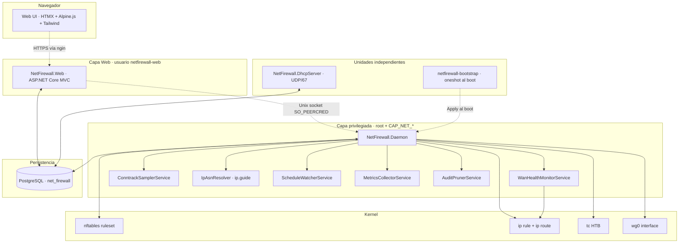
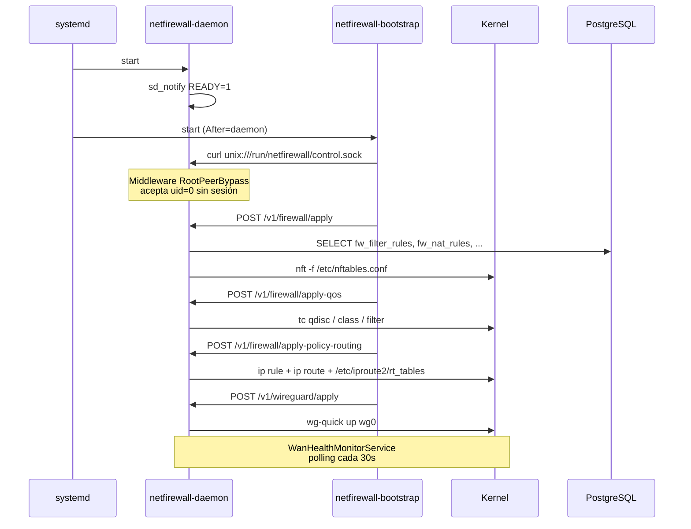
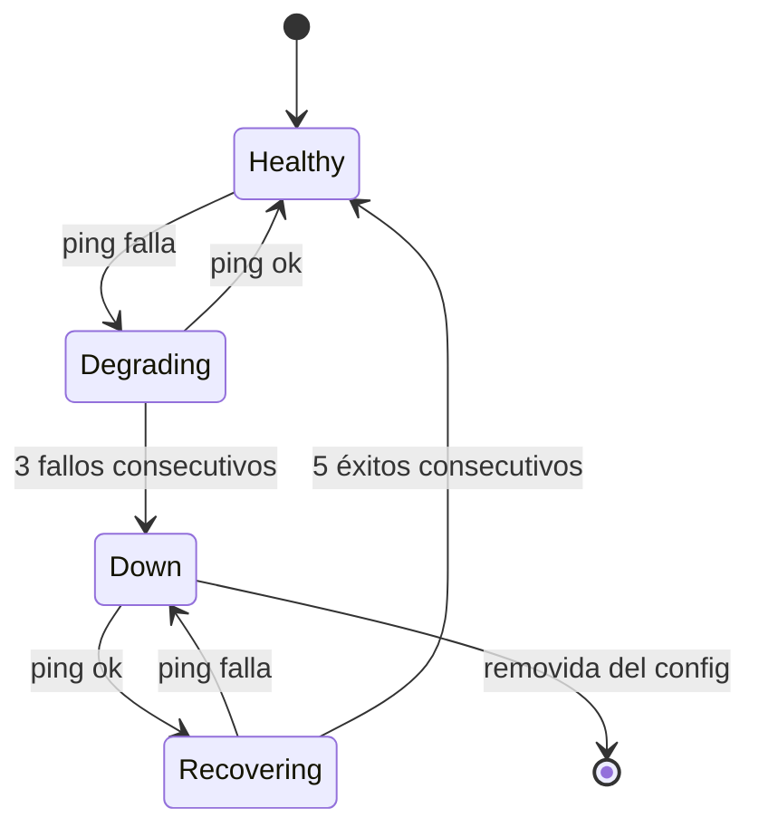

<div align="center">

[🇺🇸 English](README.md) · 🇪🇸 **Español**

# 🛡️ NetFirewall

**Firewall moderno, autohospedado y single-pane construido desde cero en C# / .NET 10**

[](https://dotnet.microsoft.com/)
[](https://www.postgresql.org/)
[](https://repodb.net/)
[](https://wiki.nftables.org/)
[](LICENSE.txt)
[]()

nftables · DHCP · WireGuard · failover dual-WAN · QoS · policy routing — todo dirigido desde una sola base de datos, aplicado por un solo daemon, administrado desde un solo Web UI.

</div>

---

## 📸 Panel principal


Vista única consolidada, actualizada en vivo vía HTMX sin recargar la página (los datos sensibles están difuminados en la captura):

- **Barra de sincronía** — estado del ruleset (`In sync` / cambios pendientes), hora del último apply y los subsistemas que tocó (nftables · tc · wireguard), con **Apply firewall** de un click.
- **Tarjetas KPI** — leases activos, interfaces (WAN vs LAN), filter rules habilitadas, throughput en vivo de todas las NICs, clientes VPN conectados.
- **Tira del servidor** — CPU, memoria, load, disco y red del host del firewall en los últimos 5 minutos como matrices de puntos, refrescadas cada 5 s desde un muestreador de `/proc` en memoria (sin ir a la base de datos). Un click abre **Monitoring → Server**.
- **Tráfico WAN** — bajada/subida en vivo por enlace (primario / secundario), más **Tráfico — últimas 24h** por interface con filtros solo-WAN / todas (Internet real in/out, sin doble conteo del NAT).
- **Salud WAN · Servicios** — alcance y latencia por enlace (la misma tarjeta que usa la página de failover) y salud systemd de daemon, web, bootstrap, DHCP, PostgreSQL, nginx y `wg-quick@wg0`.
- **A dónde va el tráfico** — los destinos más activos de toda la LAN **enriquecidos con ASN / organización / país**.
- **Top hosts / Top servicios** — totales de bytes muestreados de conntrack en ventana de 1h / 6h / 24h / 7d, con **drill-down de destinos por host**.
- **Subnets & pools · WireGuard** — utilización de leases por subnet y estado de handshake de túneles/peers.
- **Leases recientes · Port forwards · Drops en vivo** — leases DHCP más nuevos, reglas DNAT activas y las reglas drop/reject habilitadas.
- **Audit log · Alertas del sistema** — últimos cambios de configuración y eventos de WAN / VPN / failover.
- **Acciones rápidas** — recargar firewall, reiniciar `wg0`, re-aplicar routing, abrir logs — y un **footer con datos del host** (OS, kernel, virtualización, cores, RAM, uptime).

## ✨ Qué hace

| Módulo | Lo que obtienes |
|---|---|
| 🛡️ **Firewall** | Ruleset de nftables generado desde la DB — filter rules, NAT, port forwards, mangle, traffic marks. Apply con un click; backup antes de cada push. |
| 📡 **Servidor DHCP** | Servidor RFC 2131 en C# puro con PXE boot, subnets/pools/exclusiones/reservas MAC/DDNS, raw sockets AF_PACKET para manejar DISCOVER sin IP. |
| 🌐 **Failover dual-WAN** | Health monitor en el daemon pinguea cada WAN vía fwmark de policy routing (para que el probe salga por el enlace correcto), con histéresis (3 fallos → down, 5 éxitos → up). Cambio automático de default route. |
| 🔐 **VPN WireGuard** | Roles por peer — túnel upstream, cliente road-warrior, site-to-site — en una sola interface. Importa `/etc/wireguard/*.conf` existentes hacia la DB; detección de túnel caído con histéresis, banner en la UI y alertas SMTP opcionales. |
| 📊 **QoS (tc HTB)** | Hierarchical Token Bucket por interface con porcentajes de banda por traffic mark. |
| 🛣️ **Policy routing** | `fw_route_tables` + `fw_policy_rules` modelan `ip rule` + `ip route` declarativamente. El daemon reconcilia `/etc/iproute2/rt_tables` + estado del kernel. |
| 📈 **Monitoreo** | Health de servicios systemd, alcance WAN, gráficas de tráfico solo-WAN (sin doble conteo del NAT), detector de pending changes — más **Monitoring → Server**: un monitor del host que muestrea `/proc` cada segundo en memoria (la última hora, unos cientos de KB, ~µs por muestra) y muestra CPU (user / system / I/O wait), memoria, load, disco y throughput de las NICs como matrices de puntos en 1m / 5m / 15m / 1h, los programas que más consumen y los filesystems locales. |
| 🌍 **Tráfico por destino** | El sampler de conntrack registra *a dónde* va el tráfico de cada host de la LAN (top-N destinos por host), enriquecido con ASN/org/país vía [ip.guide](https://ip.guide) (cacheado por prefijo). Haz drill-down en cualquier host para ver sus destinos. |
| 🩺 **Diagnósticos** | Ping por fwmark, oráculo de rutas, búsqueda en conntrack, log de drops, salud de interfaces, sanidad de sysctl — más **cuatro doctores** (VPN, WAN, DHCP, DNS), un **inspector de flujos** (tabla de trace temporal, siempre se limpia), **captura tcpdump** acotada y **speed test** por WAN fijado con `SO_MARK`. Cada ejecución queda en el historial. |
| ⏰ **Wake-on-LAN** | Dispositivos guardados (unidos al DHCP por MAC), despertar uno / seleccionados / todos; el daemon envía el magic packet atado al enlace LAN correcto. También hay botones Wake en reservas y leases DHCP. |
| 🧙 **Setup wizard** | Generador del rule set inicial — arquetipo Gateway / Router / Bastion + toggles de capacidades → reglas default-deny sobre network objects con nombre. Idempotente. |
| 💻 **Terminal web** | Shell root solo para admins en el navegador (xterm.js sobre un PTY en el daemon), protegida con TOTP. |
| 🖥️ **TUI + Doctor** | `netfirewall-tui` para administrar desde consola y recuperación de emergencia (reset de password / TOTP / lockout); `netfirewall-doctor` valida env, sincronía de master key, units, socket, DHCP y PostgreSQL (`--json` para CI). |
| 👤 **Auth** | Session cookies, enrollment TOTP + recovery codes, elevation para ops destructivas, audit log completo. |

## 🏗️ Arquitectura



El daemon es el único proceso que muta el kernel. El Web corre sin capabilities, y se comunica con el daemon vía Unix socket protegido por `SO_PEERCRED` + session token. La configuración persistente vive en PostgreSQL; el estado del kernel es una vista derivada que el daemon reconcilia bajo demanda.

## ⚙️ Componentes

```
NetFirewall/
├── NetFirewall.Daemon           # HTTP sobre Unix socket privilegiado — toda mutación del kernel pasa aquí
├── NetFirewall.Web              # ASP.NET Core MVC — HTMX + Alpine.js + Tailwind 4
├── NetFirewall.DhcpServer       # RFC 2131 + PXE — unidad systemd independiente
├── NetFirewall.Tui              # TUI en Spectre.Console para admin de emergencia
├── NetFirewall.Doctor           # Validador de requisitos (netfirewall-doctor)
├── NetFirewall.Services         # Lógica de negocio + Npgsql + sql/migrations/
├── NetFirewall.Models           # POCOs (DHCP, Firewall, Vpn, WanMonitor, Auth)
├── NetFirewall.Migrations       # Runner SQL forward-only
├── NetFirewall.Benchmarks       # BenchmarkDotNet para validar hot paths
├── NetFirewall.Tests            # xUnit + Aspire.Hosting.Testing
└── deploy/
    ├── systemd/                 # Units endurecidas
    ├── bootstrap/               # Script /usr/local/bin/netfirewall-bootstrap
    ├── nginx/                   # Ejemplo de reverse proxy
    ├── seeds/                   # Seed SQL por deployment
    ├── debian/ firstboot/ iso/  # Appliance .deb + ISO Debian 13
    └── install.sh               # Instalador one-shot
```

## 🚀 Inicio rápido

### Requisitos

- 🐧 Debian 13 / Ubuntu 24.04 / Rocky 9 (systemd moderno + kernel 5.x+)
- 🟣 .NET 10 SDK + runtime
- 🐘 PostgreSQL 18+
- 🔧 Paquetes `nftables`, `iproute2`, `wireguard-tools`, `conntrack`
- 🌐 nginx (o cualquier reverse proxy) para terminar TLS

### Instalar las dependencias del sistema

`deploy/install.sh` **no** instala paquetes del SO — solo verifica que estén
presentes (`systemctl`, `dotnet`, `psql`, `openssl`) y aborta si falta alguno.
Instala primero todo lo que el daemon invoca en tiempo de ejecución: `nft`,
`ip`, `tc`, `wg` / `wg-quick`, `conntrack`, `ping` y `systemctl`.

**Debian / Ubuntu**

```bash
# herramientas que el daemon ejecuta en runtime
apt update
apt install -y nftables iproute2 wireguard-tools conntrack iputils-ping \
               openssl curl ca-certificates

# PostgreSQL 18+ (servidor + cliente; el runner de migraciones usa psql)
apt install -y postgresql postgresql-client

# nginx para terminar TLS (omítelo si usas otro reverse proxy)
apt install -y nginx

# .NET 10 SDK — feed de Microsoft (Debian/Ubuntu)
#   ver https://learn.microsoft.com/dotnet/core/install/linux según tu release
apt install -y dotnet-sdk-10.0      # o baja el tarball y agrégalo al PATH
```

**Rocky / Alma / RHEL 9**

```bash
dnf install -y nftables iproute-tc wireguard-tools conntrack-tools iputils \
               openssl curl postgresql-server postgresql nginx dotnet-sdk-10.0
postgresql-setup --initdb        # init del cluster PG la primera vez (familia RHEL)
systemctl enable --now postgresql
```

**openSUSE**

```bash
zypper install -y nftables iproute2 wireguard-tools conntrack-tools iputils \
                  openssl curl postgresql-server postgresql nginx dotnet-sdk-10.0
```

> Nombres de paquete: `conntrack` (Debian) = `conntrack-tools` (RHEL/SUSE);
> `tc` viene en `iproute2` (Debian) pero en `iproute-tc` (RHEL); `ping` está en
> `iputils-ping` (Debian) / `iputils` (RHEL/SUSE).

### Habilitar funciones del kernel

El firewall es un router, así que el forwarding IPv4 debe estar activo, y el
panel de top-talkers necesita contabilidad de bytes en conntrack (`conntrack -L`
solo emite `bytes=` cuando `nf_conntrack_acct=1`). El instalador deja
`/etc/sysctl.d/netfirewall.conf` con `nf_conntrack_acct`, pero **el forwarding
es decisión tuya** — actívalo explícitamente:

```bash
# persistente: escribe un drop-in de sysctl y aplícalo
cat >/etc/sysctl.d/99-netfirewall-router.conf <<'EOF'
net.ipv4.ip_forward = 1
net.netfilter.nf_conntrack_acct = 1
EOF
sysctl --system

# verificar
sysctl net.ipv4.ip_forward net.netfilter.nf_conntrack_acct
```

> **Policy routing + `rp_filter`:** el filtrado estricto de ruta inversa
> (`net.ipv4.conf.*.rp_filter=1`) descarta silenciosamente tráfico enrutado por
> fwmark cuya ruta de respuesta difiere de la interfaz de entrada. Si el tráfico
> marcado no sale por la WAN/VPN esperada aunque `ip rule` + la tabla de rutas
> se vean bien, relájalo: `sysctl -w net.ipv4.conf.all.rp_filter=2` (modo loose).
> Ver diagnóstico abajo.

### Instalación

```bash
git clone https://github.com/your-org/NetFirewall /opt/tekium/src
cd /opt/tekium/src
deploy/install.sh
```

El instalador publica los cinco binarios (`daemon`, `web`, `dhcp-server`, `migrations`, `tui`), crea el grupo `netfirewall` + usuario `netfirewall-web`, prepara `/etc/netfirewall/`, `/var/lib/netfirewall/`, `/var/log/netfirewall/`, genera una llave maestra AES-256 para cifrar TOTP, aplica todas las migraciones y arranca los servicios.

### Verificación

```bash
systemctl status netfirewall-*
nft list ruleset | head
curl -sS https://fw.example.com/login
```

Abre `https://fw.example.com/setup/bootstrap?token=<token-impreso-en-journalctl>` para crear el primer admin.

## 🔄 Workflow de apply al boot



## 🌐 Failover dual-WAN

El `WanHealthMonitorService` del daemon corre cada 30s por defecto. Para cada fila habilitada de `wan_health_config`:

1. **Probe** — `ping -m <fwmark>` a cada target. El fwmark fuerza al kernel a respetar `ip rule fwmark X lookup wanN`, por lo que el probe sale por la WAN que se está probando incluso cuando el main table apunta a otra.
2. **Histéresis** — 3 fallos consecutivos marcan la WAN como `is_up=false`; 5 éxitos consecutivos la marcan como `is_up=true`.
3. **Reconciliación** — gana la WAN healthy con menor priority. Si cambió el ganador, `ip route replace default via <gw> dev <iface>` en la tabla main.
4. **Auditoría** — `wan_health_events` registra cada transición; `fw_apply_history` registra cada failover.



## 🗄️ Esquema de DB (42 migraciones)

| Rango | Dominio |
|---|---|
| `00001–00004` | Extensions + firewall core (interfaces, filter/NAT/mangle rules, traffic marks, static routes, QoS, audit log) |
| `00005–00010` | DHCP (legacy + subnets + pools + opciones + relay + failover + DDNS + setup wizard) |
| `00011` | Auth (users, sessions, secrets TOTP, auth audit log) |
| `00012–00013` | Métricas del sistema + app settings |
| `00014, 00021` | WireGuard (servers, peers, modos server/client) |
| `00015–00020` | Network objects, FQDN sets, perfil de usuario, search index, schedules, services |
| `00022` | Apply history (detección de drift por kind) |
| `00023` | Policy routing (named tables + reglas fwmark) |
| `00024` | LAN traffic samples (top talkers desde conntrack) |
| `00025–00026` | WAN health + probe fwmark |
| `00027–00029` | Tráfico por destino, cache de ASN, métricas de red |
| `00030–00031` | Índice de búsqueda global (DHCP + firewall) |
| `00032–00033, 00036–00037` | Modos de ruta WireGuard, monitor de salud VPN, roles de peer (upstream / client / site) |
| `00034–00035` | Auto-seed de WAN health + override manual de la WAN activa |
| `00038–00040` | Notify al borrar leases DHCP, inversión de horarios, limpieza de huérfanos |
| `00041` | Historial de diagnósticos (`diag_runs`) |
| `00042` | Dispositivos Wake-on-LAN |

Forward-only; la tabla `__migrations` guarda el SHA-256 de cada archivo aplicado para detectar drift.

## 🔐 Hardening

- **Separación de privilegios** — Daemon corre como root con `CapabilityBoundingSet=CAP_NET_ADMIN CAP_DAC_OVERRIDE CAP_NET_RAW CAP_CHOWN`. Web corre como `netfirewall-web` sin capabilities. Bootstrap es un oneshot que invoca al daemon vía Unix socket.
- **Sandbox de systemd** — `ProtectSystem=strict`, `ProtectKernelTunables/Modules/Logs`, `RestrictAddressFamilies` ajustadas por servicio (AF_PACKET para DHCP, AF_NETLINK para daemon), `SystemCallFilter=@system-service` menos `@mount @swap @reboot @raw-io`.
- **Flujo de auth** — Session cookie solo sobre HTTPS, TOTP obligatorio en el primer login, **elevation** (re-prompt TOTP) para endpoints destructivos (`apply firewall`, `update interface`, etc.).
- **Cifrado de TOTP** — la master key vive solo dentro del daemon (cargada desde `/etc/netfirewall/daemon.env`). El Web hace `POST /v1/crypto/encrypt|decrypt` por el Unix socket — un compromiso del Web no puede descifrar los secrets almacenados.

## 🛠️ Operaciones

### Apply manual vía curl (con bypass de root peer)

```bash
SOCK=/run/netfirewall/control.sock
curl --unix-socket "$SOCK" -X POST http://daemon/v1/firewall/apply
curl --unix-socket "$SOCK" -X POST http://daemon/v1/firewall/apply-qos
curl --unix-socket "$SOCK" -X POST http://daemon/v1/firewall/apply-policy-routing
curl --unix-socket "$SOCK" -X POST http://daemon/v1/wireguard/apply
```

### Republicar tras un cambio de código

Editar el código **no** cambia nada en el kernel hasta republicar los binarios,
reiniciar los servicios y volver a aplicar. El generador de nftables vive en
`NetFirewall.Services`, que enlazan tanto el daemon como el web → republica
ambos:

```bash
cd /opt/tekium/src && git pull        # trae los cambios
dotnet publish -c Release -r linux-x64 -o /opt/tekium/daemon NetFirewall.Daemon
dotnet publish -c Release -r linux-x64 -o /opt/tekium/web    NetFirewall.Web
systemctl restart netfirewall-daemon netfirewall-web
# luego: UI → Firewall → Apply (TOTP), o el curl de "Apply manual" de arriba
```

### Diagnóstico

Cuando algo "está configurado pero no funciona", recorre la cadena desde el
kernel hacia abajo. Todo es de solo lectura — seguro en un equipo en producción.

**Servicios y sockets**

```bash
systemctl status netfirewall-daemon netfirewall-web
journalctl -u netfirewall-daemon -n 100 --no-pager
journalctl -u netfirewall-web    -n 100 --no-pager
ls -l /run/netfirewall/control.sock                    # socket Unix del daemon (0660 root:netfirewall)
curl --unix-socket /run/netfirewall/control.sock http://daemon/v1/health
```

**nftables — ¿el ruleset es el esperado?**

```bash
nft list ruleset                       # todo
nft list table ip filter
nft list table ip nat                  # DNAT / masquerade
nft list table ip mangle               # marcado fwmark (policy routing)
nft -c -f /etc/nftables.conf           # valida el archivo generado SIN aplicarlo
```

> Trampa del mangle: cada regla de marcado debe terminar en `... meta mark set
> 0xNNN return`. `meta mark set` **no** es terminal — sin `return`, una regla
> más amplia posterior (p.ej. `192.168.99.0/24 → WAN1`) sobreescribe la marca de
> un host específico de arriba, y ese host sale por el enlace equivocado.

**Policy routing — ¿la marca llega a la tabla y device correctos?**

```bash
ip rule show                                       # mapeos fwmark → tabla
ip route show table all | grep -i wg0
ip route show table wg0                            # una tabla nombrada (o: table <id>)
cat /etc/iproute2/rt_tables

# LA prueba definitiva: ¿por qué device saldría un paquete marcado del host X?
ip route get 8.8.8.8 from 192.168.99.66 mark 0x500   # esperado: dev wg0
```

**Conntrack / top-talkers (panel del dashboard vacío)**

```bash
# el binario debe existir (Debian: conntrack · RHEL/SUSE: conntrack-tools)
which conntrack || apt install -y conntrack
which conntrack && conntrack -V

# la contabilidad de bytes DEBE estar en 1, si no `bytes=` no aparece y el panel queda vacío
sysctl net.netfilter.nf_conntrack_acct
sysctl -w net.netfilter.nf_conntrack_acct=1          # activar en caliente si está en 0

# ¿hay flujos y traen bytes=?
conntrack -L -o extended 2>/dev/null | head -5
conntrack -L -o extended 2>/dev/null | wc -l
conntrack -L -o extended 2>/dev/null | head -3 | grep -o "bytes=[0-9]*"
conntrack -L -s 192.168.99.66 2>/dev/null | head     # flujos desde un origen

# ¿el sampler del daemon está leyendo conntrack?
journalctl -u netfirewall-daemon --since "10 min ago" | grep -i "conntrack\|sampler\|lan_traffic"
```

**WireGuard**

```bash
wg show                                  # peers, handshakes, transferencia
wg show wg0 allowed-ips
ip -br addr show wg0
wg-quick up wg0                          # levantar manualmente (normalmente lo hace el daemon)
```

**WAN / forwarding**

```bash
sysctl net.ipv4.ip_forward               # debe ser 1 para un router
ping -m 256 -c2 1.1.1.1                  # probar una WAN por su probe fwmark (policy routing ignora -I)
ip route show default
```

**Apply history (DB)**

```sql
SELECT kind, success, applied_at, applied_by, message
FROM fw_apply_history ORDER BY applied_at DESC LIMIT 20;
```

### Migraciones

```bash
bin/db.sh status   # qué está aplicado / pendiente / con drift
bin/db.sh up       # aplica pendientes
bin/db.sh seed     # aplica seed demo (SOLO DEV)
```

### Audit + apply history

```sql
SELECT event_type, username, ip, occurred_at FROM auth_audit_log ORDER BY occurred_at DESC LIMIT 20;
SELECT kind, success, applied_at, applied_by, message FROM fw_apply_history ORDER BY applied_at DESC LIMIT 20;
```

## ⚠️ Obsoleto

Estos artefactos quedan en el repo como referencia pero ya no se usan en producción:

| Componente | Reemplazado por | Notas |
|---|---|---|
| `/root/firewall.sh` (o `Bash/firewall.sh`) | `netfirewall-bootstrap.service` + `fw_policy_rules` + `fw_route_tables` desde DB | El script viejo hacía `ip rule add` y `ip route add` directo; ahora lo reconcilia `IPolicyRoutingApplyService` desde la DB. |
| `NetFirewall.WanMonitor` (proceso standalone) | `WanHealthMonitorService` (HostedService dentro del daemon) | El monitor viejo shelleaba comandos y no tenía estado en DB. El nuevo persiste `wan_health_state` + `wan_health_events`. |
| `netfirewall-wanmonitor.service` | (ninguno — absorbido al daemon) | Desactiva y elimina si vienes de un deploy pre-2026-05. |
| `BashCommandsConfig.Extra{Primary,Secondary}Commands` | Endpoints de Apply del daemon | El WanMonitor viejo ejecutaba esas listas de bash en failover; el daemon ahora hace lo equivalente declarativamente. |

## 📖 Documentación

- [`docs/DEPLOY_HANDOFF.md`](docs/DEPLOY_HANDOFF.md) — estado del deployment + notas de handoff
- [`docs/PerformanceAnalysis.md`](docs/PerformanceAnalysis.md) — budget del hot path DHCP + reglas zero-allocation
- [`docs/DHCP_FEATURE_COMPARISON.md`](docs/DHCP_FEATURE_COMPARISON.md) — paridad de features vs isc-dhcp / kea
- [`docs/diagnostics.md`](docs/diagnostics.md) — sección de Diagnósticos: herramientas, doctores, historial, reglas de seguridad
- [`docs/appliance-iso.md`](docs/appliance-iso.md) — appliance `.deb` + ISO Debian 13, aprovisionamiento en el primer arranque
- [`docs/doctor.md`](docs/doctor.md) — checks y remedios de `netfirewall-doctor`
- [`docs/master-key.md`](docs/master-key.md) — master key de TOTP: ubicación, regla de sincronía daemon ↔ Web
- [`docs/wake-on-lan.md`](docs/wake-on-lan.md) — diseño y uso de Wake-on-LAN
- [`CLAUDE.md`](CLAUDE.md) — reglas del proyecto (no negociables)

## 📜 Licencia

MIT — ver [LICENSE.txt](LICENSE.txt).

---

<div align="center">

**Construido con ❤️ en C# / .NET 10 · Powered by PostgreSQL + RepoDB + nftables**

</div>
