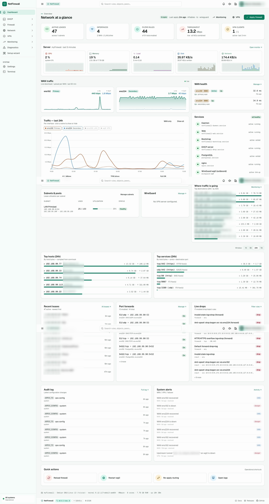
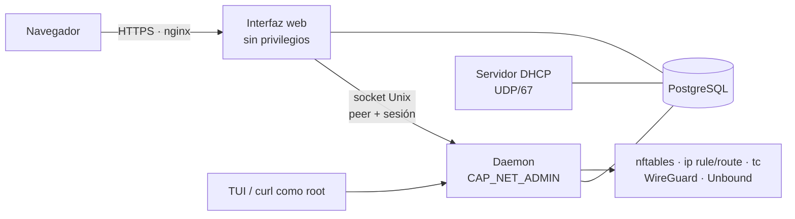

<div align="center">

[🇺🇸 English](README.md) · 🇪🇸 **Español**

# 🛡️ NetFirewall

**Un firewall Linux que manejas desde el navegador, donde la base de datos es la configuración.**

[](https://dotnet.microsoft.com/)
[](https://www.postgresql.org/)
[](https://wiki.nftables.org/)
[](LICENSE.txt)
[]()

</div>

Reglas de firewall, DHCP, WireGuard, dos enlaces a Internet, QoS y policy routing, todo
guardado en una base PostgreSQL y convertido en nftables, rutas y túneles por un pequeño
daemon privilegiado. Se administra desde una interfaz web, una TUI de consola o la shell.
Corre en un Debian o Ubuntu normal y se instala desde un solo tarball.


<sub>El panel de un firewall en producción con dos WAN. Los nombres, las direcciones MAC y los destinos públicos están difuminados.</sub>

## La idea

La mayoría de los firewalls pequeños son una distribución que no puedes cambiar o un
montón de scripts que da miedo tocar. NetFirewall se apoya en unas pocas reglas:

**La base de datos es la configuración.** Cada regla, lease, peer y ruta vive en
PostgreSQL. El kernel tiene una copia derivada de ella: *Apply* la regenera, el equipo la
vuelve a aplicar en cada arranque y la interfaz avisa cuando las dos se separan. Respaldar
la base es respaldar el firewall.

**Un solo proceso puede tocar el kernel.** La interfaz web corre como un usuario sin
privilegios ni capabilities. Cada cambio a nftables, rutas, `tc` o WireGuard pasa por un
daemon en un socket Unix que verifica quién llama (`SO_PEERCRED`) y con qué sesión. Entrar
al proceso web no te da root ni los secretos TOTP.

**Todo cambio se puede deshacer.** Las acciones destructivas vuelven a pedir tu código
TOTP. Cada apply guarda un backup. Una actualización que no vuelve sana se revierte sola.
Dividir una interfaz VPN se revierte por sí misma si no la confirmas en 10 minutos. Una
regla cuyos objetos no resuelven a nada se omite, nunca se amplía a "cualquiera".

**No se descarga nada en tiempo de ejecución.** Scripts, estilos, fuentes y hasta la llave
del repositorio de PostgreSQL viajan en el bundle, así que la interfaz nunca carga nada de Internet.

## Qué puedes hacer con él

**Mantener Internet arriba.** Dos WAN, cada una probada con su propia marca de ruteo para
que la prueba salga de verdad por el enlace que se está probando. Si la principal cae, la
ruta por defecto se mueve. Cuando vuelve, la ruta regresa. Tráfico y latencia por WAN, y
una prueba de velocidad fijada a un enlace.

**Decidir qué habla con qué.** Reglas de filtro, NAT y port forwards sobre objetos de red y
conjuntos FQDN con nombre en vez de direcciones sueltas. Horarios ("bloquear los equipos
de los niños después de las 22:00"), porcentajes de QoS por clase de tráfico y policy
routing ("que la TV salga por el proveedor VPN"). Un asistente escribe un conjunto inicial
default-deny para un gateway, un router o un bastión.

**Administrar la LAN.** Un servidor DHCP escrito en C# para este proyecto, conforme al
RFC 2131, con alrededor de un microsegundo de CPU por paquete. Ofrece:
- reservas, con nombres que puedes usar con `ping` porque se publican en el DNS del firewall
- clases de cliente, opciones personalizadas para teléfonos y access points, arranque PXE e iPXE
- un ping antes de entregar una dirección
- historial de leases de 90 días
- alertas cuando un pool se llena o aparece otro servidor DHCP en tu red

Wake-on-LAN para los equipos guardados.

**Conectarse desde afuera, y hacia afuera.** Un servidor VPN WireGuard para laptops,
teléfonos y sucursales, con configs en QR. Túneles *salientes* aparte hacia un proveedor VPN
o una oficina remota, que creas pegando su config. Alertas de túnel caído por banner y correo.

**Ver qué está pasando y por qué.** Un panel en vivo (arriba):
- qué equipos usan más tráfico, y a dónde va, con la organización y el país detrás de cada dirección
- gráficas por WAN
- CPU, memoria y disco del equipo

Cuando algo falla:
- cuatro "doctores" (WAN, VPN, DHCP, DNS) que revisan toda la cadena y dicen qué arreglar
- un oráculo de rutas ("¿por qué enlace saldría este paquete?")
- un inspector que sigue una conexión dentro del kernel
- capturas de paquetes acotadas
- una terminal root en el navegador protegida con TOTP

**Administrarlo con seguridad.** TOTP en cada cuenta, códigos de recuperación, log de
auditoría completo, y `netfirewall-tui` en la consola para resetear una contraseña o un TOTP
bloqueado cuando la web no es opción. `netfirewall-doctor` revisa toda la instalación en una tabla.

## Instalar

En Debian 12/13 o Ubuntu 22.04+ (x86_64 o arm64), como root. El bundle trae su propio
runtime de .NET; `setup.sh` instala lo demás que falte, incluido PostgreSQL 19 del
repositorio oficial.

```bash
tar xzf netfirewall-0.9.0.tar.gz && cd netfirewall-0.9.0   # de GitHub Releases
./setup.sh --preflight     # revisa el host; no cambia nada
./setup.sh                 # instala y luego corre netfirewall-doctor
journalctl -u netfirewall-web | grep -i bootstrap          # enlace de un solo uso para el primer admin
```

**Actualizar:** corre `./setup.sh` desde un bundle más nuevo. Respalda la base, migra,
cambia de versión, verifica la salud y se revierte solo si la versión nueva no arranca.
**Revertir a mano:** `./setup.sh --rollback`.

Base remota, DHCP en una interfaz dada, tu propio certificado TLS o proxy, equipos ARM y
qué hace cada paso cuando falla: **[docs/setup.md](docs/setup.md)**.

## Cómo encaja todo



| Pieza | Qué hace |
|---|---|
| `NetFirewall.Web` | ASP.NET Core MVC con HTMX, Alpine.js y Tailwind; grillas de datos de [NetOpenGrid](https://github.com/mchinchilla/NetOpenGrid) |
| `NetFirewall.Daemon` | El único proceso privilegiado: aplica el estado, corre los monitores WAN/VPN, el muestreador de tráfico y las herramientas de diagnóstico |
| `NetFirewall.DhcpServer` | El servidor DHCP, en su propia unit de systemd |
| `NetFirewall.Tui` · `NetFirewall.Doctor` · `NetFirewall.Migrations` | Administración por consola, verificador de la instalación, migraciones del esquema solo hacia adelante |
| `deploy/` | `build-bundle.sh` y `setup.sh`, units de systemd endurecidas, sitio nginx, apply al arrancar |

Cada unit corre en un sandbox estricto de systemd (`ProtectSystem=strict`, límite de
capabilities, filtro de syscalls). El daemon solo tiene `CAP_NET_ADMIN CAP_NET_RAW CAP_DAC_OVERRIDE CAP_CHOWN`.

## Límites

Conviene saberlos antes de ponerlo delante de tu red:

- **Solo IPv4.** Todavía no hay DHCPv6, router advertisements ni reglas IPv6.
- **Un solo equipo.** El failover DHCP entre dos firewalls está desactivado: el protocolo
  entre pares no está implementado, y activarlo detenía el DHCP en ambos.
- **Debian y Ubuntu** con systemd son los únicos hosts probados.
- **Dos funciones salen a Internet a propósito:** la organización y el país de un destino
  vienen de [ip.guide](https://ip.guide) (en caché por prefijo), y la prueba de velocidad descarga archivos de prueba.

## Desarrollo

```bash
dotnet build                                          # también compila Tailwind (binario standalone, nunca npm)
dotnet test                                           # ~1900 pruebas; las de base necesitan un PostgreSQL local
dotnet run --project NetFirewall.Migrations -- up     # migra la base de desarrollo
dotnet run --project NetFirewall.AppHost              # Aspire: Web + ApiService + servidor DHCP
deploy/build-bundle.sh --rid linux-arm64              # un bundle de release → dist/
```

Las reglas del proyecto (nada de npm, async en todo, un solo CSS y un solo JS, solo tokens
de tema, nada de SQL en los controllers…) están en [CLAUDE.md](CLAUDE.md). Cada push a
`master` corre las pruebas y publica el siguiente release (`[minor]` / `[major]` /
`[skip release]` en el mensaje del commit lo cambian).

## Documentación

| | |
|---|---|
| [setup.md](docs/setup.md) | Instalar, actualizar, revertir, cada opción de `setup.sh`, PostgreSQL 19 |
| [operations.md](docs/operations.md) | Apply al arrancar, lógica del failover, diagnóstico desde la shell, historia del esquema |
| [diagnostics.md](docs/diagnostics.md) | La sección Diagnostics: herramientas, doctores, reglas de seguridad |
| [doctor.md](docs/doctor.md) | Chequeos y remedios de `netfirewall-doctor` |
| [master-key.md](docs/master-key.md) | La master key de TOTP y la regla de sincronía daemon ↔ web |
| [DHCP_FEATURE_COMPARISON.md](docs/DHCP_FEATURE_COMPARISON.md) | Funciones del DHCP frente a Kea, dnsmasq y MikroTik |
| [PerformanceAnalysis.md](docs/PerformanceAnalysis.md) | El camino caliente del DHCP y sus reglas de asignación |
| [wake-on-lan.md](docs/wake-on-lan.md) | Wake-on-LAN |

## Licencia

MIT, ver [LICENSE.txt](LICENSE.txt).
