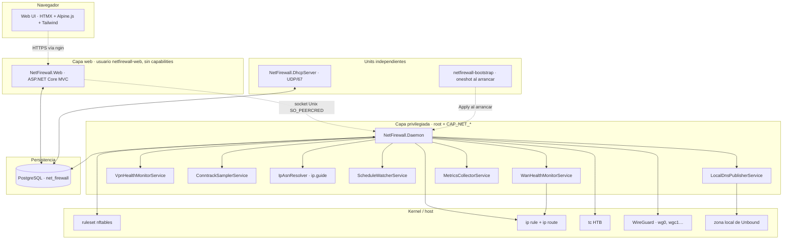
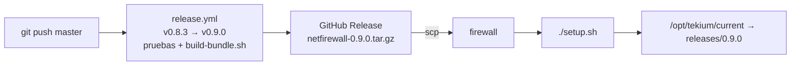
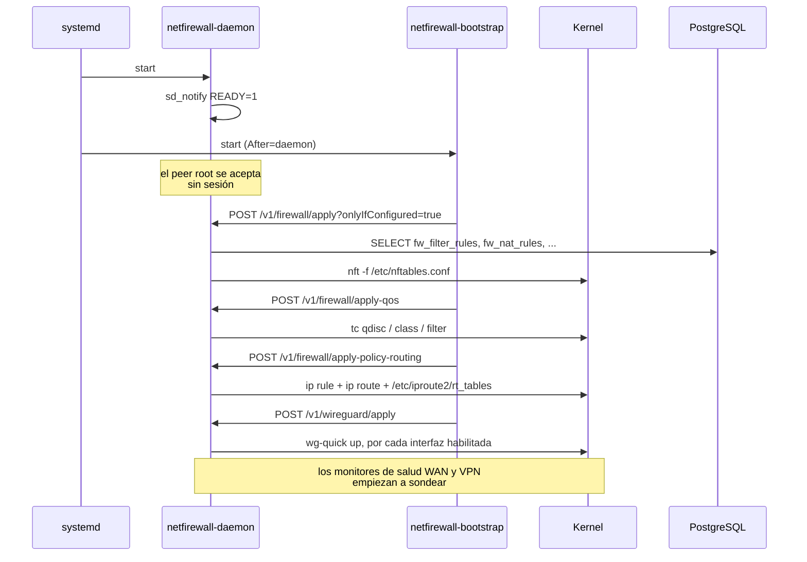
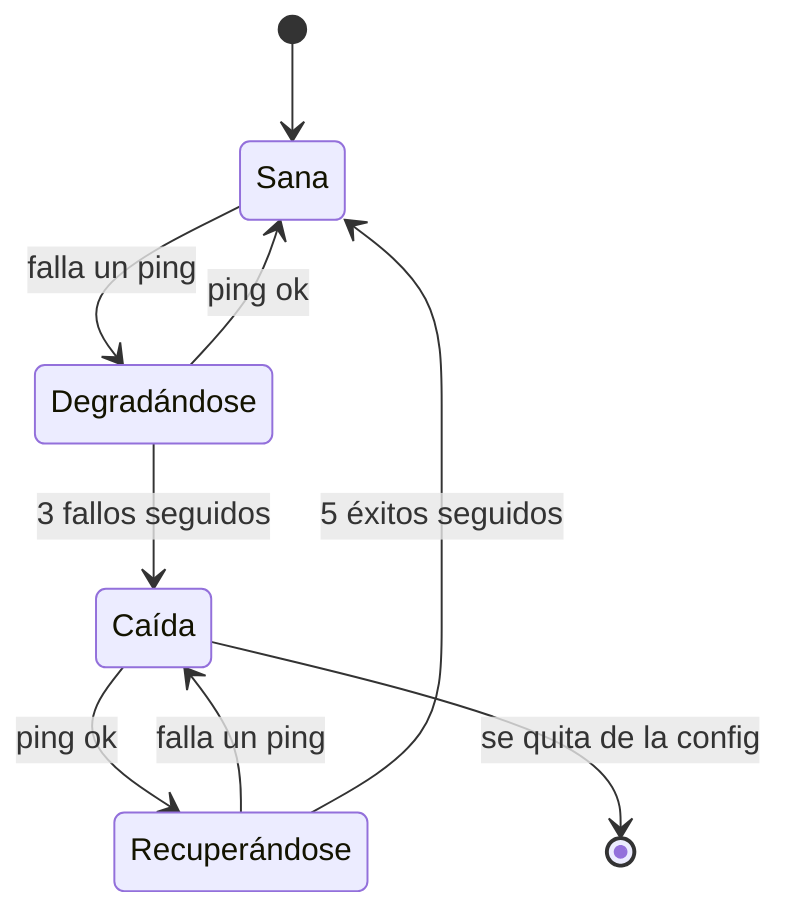
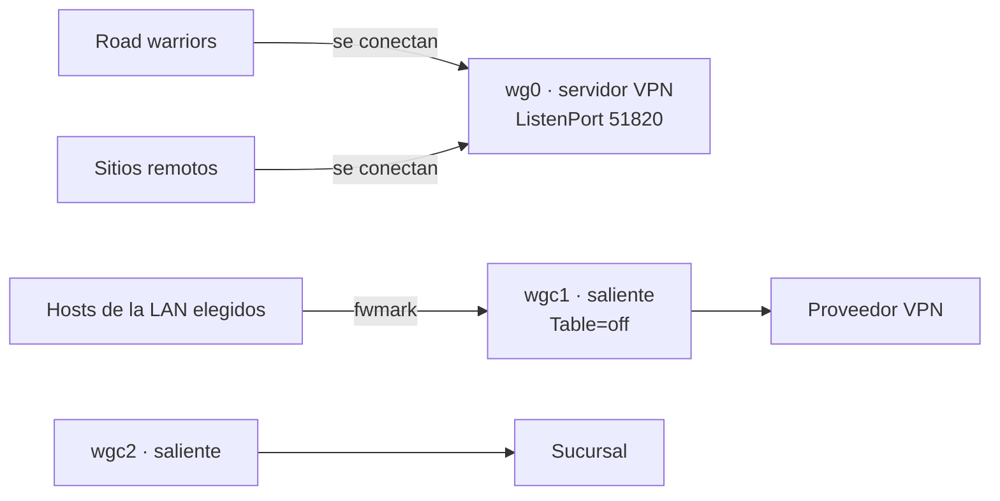

<div align="center">

[🇺🇸 English](README.md) · 🇪🇸 **Español**

# 🛡️ NetFirewall

**Firewall moderno, autohospedado y de panel único, construido desde cero en C# / .NET 11**

[](https://dotnet.microsoft.com/)
[](https://www.postgresql.org/)
[](https://repodb.net/)
[](https://wiki.nftables.org/)
[](LICENSE.txt)
[]()

nftables · DHCP · WireGuard · failover dual-WAN · QoS · policy routing · diagnóstico: todo desde una sola base de datos, aplicado por un solo daemon y administrado desde una sola interfaz web.

</div>

---

## 📸 Panel principal


Una sola página de resumen, actualizada en vivo con HTMX sin recargar. En la captura están difuminados los nombres de personas y de dispositivos, las direcciones MAC y los destinos públicos.

- **Barra de sincronía**: si el kernel coincide con la base de datos (`In sync` o cambios pendientes), cuándo fue el último apply y qué tocó (nftables · tc · wireguard), con **Apply firewall** de un click.
- **Tarjetas KPI**: leases activos, interfaces (WAN vs LAN), reglas de filtro habilitadas, throughput en vivo de todas las NICs, clientes VPN conectados.
- **Tira del servidor**: CPU, memoria, load, disco y red del host en los últimos 5 minutos como matrices de puntos, refrescadas cada 5 s desde un muestreador de `/proc` en memoria (sin ir a la base). Abre **Monitoring → Server**.
- **Tráfico WAN**: bajada/subida en vivo por enlace (primario / secundario), más **Tráfico, últimas 24 h** por interfaz con selector solo-WAN / todas (tráfico real de Internet, sin contar dos veces el NAT).
- **Salud WAN · Servicios**: alcance y latencia por enlace (la misma tarjeta que usa la página de failover), y la salud del daemon, la web, el bootstrap, el servidor DHCP, PostgreSQL, nginx y **cada interfaz WireGuard según el estado de su enlace**.
- **A dónde va el tráfico**: los destinos más usados de la LAN, **con ASN, organización y país**.
- **Top hosts / Top servicios**: bytes muestreados de conntrack en 1h / 6h / 24h / 7d, con **detalle de destinos** por host.
- **Subnets y pools · WireGuard**: uso de leases por subnet, y los peers y handshakes del servidor VPN.
- **Leases recientes · Port forwards · Drops en vivo**: los leases DHCP más nuevos, las reglas DNAT activas y las reglas drop/reject habilitadas.
- **Auditoría · Alertas del sistema**: los últimos cambios de configuración y los eventos WAN / VPN / DHCP (failover, túnel caído, pool casi lleno, servidor DHCP ajeno).
- **Acciones rápidas** (recargar firewall, reiniciar un túnel, re-aplicar routing, ver logs) y un **pie con datos del host** (SO, kernel, virtualización, núcleos, RAM, uptime).

## ✨ Qué hace

| Módulo | Qué obtienes |
|---|---|
| 🛡️ **Firewall** | Ruleset nativo de nftables generado desde la base: reglas de filtro, NAT, port forwards, mangle, marcas de tráfico, horarios (incluido "bloquear fuera de esta ventana"), objetos de red con nombre y conjuntos FQDN. Apply de un click con backup antes de cada cambio. Una regla cuyos objetos no resuelven a nada se omite, nunca se amplía. |
| 📡 **Servidor DHCP** | C# puro, conforme a RFC 2131, unos 0,9 µs de CPU por paquete. Subnets, pools, exclusiones, reservas con nombre DNS, clases de cliente (los 8 tipos de coincidencia) con permitir/denegar por pool, **opciones personalizadas** (teléfonos VoIP, access points, WPAD…), PXE BIOS/UEFI + iPXE, relay agents y opción 82. Hace ping a una dirección antes de ofrecerla, reserva las ofertas y le re-ofrece a cada cliente su lease actual. Los nombres de los equipos se publican en el DNS del firewall (`ping nas.lan`), DDNS RFC 2136 en segundo plano, **historial de leases** de 90 días, alertas de pool agotado o de un **servidor DHCP ajeno**. Sockets AF_PACKET por interfaz. |
| 🌐 **Failover dual-WAN** | El daemon hace ping por cada WAN con su propio fwmark (para que la prueba salga por el enlace que se está probando), con histéresis (3 fallos → caído, 5 éxitos → arriba), y cambia la ruta por defecto cuando cambia el ganador. Override manual. |
| 🔐 **VPN WireGuard** | **Una interfaz por rol.** El **servidor VPN** (`wg0`: road warriors y sitios que se conectan, configs con QR) y las **conexiones salientes** (`wgc1`, `wgc2`…: un proveedor VPN o un sitio remoto, creadas pegando una config). Enrutar hosts elegidos de la LAN por un túnel, subnets site-to-site, importar `/etc/wireguard/*.conf` existentes. Detección de túnel caído con histéresis, banner y alertas SMTP opcionales. Un `wg0` viejo que hace las dos cosas se puede **dividir** con vista previa y 10 minutos para confirmar o revertir. |
| 📊 **QoS (tc HTB)** | Hierarchical Token Bucket por interfaz con porcentajes por marca de tráfico. |
| 🛣️ **Policy routing** | `fw_route_tables` + `fw_policy_rules` describen `ip rule` + `ip route` de forma declarativa; el daemon reconcilia `/etc/iproute2/rt_tables` y el kernel. |
| 📈 **Monitoreo** | Salud de servicios systemd, alcance de las WAN, gráficas de tráfico solo-WAN, detector de cambios pendientes, y **Monitoring → Server**: CPU (usuario / sistema / espera de E/S), memoria, load, disco y throughput por NIC muestreados cada segundo en memoria, como matrices de puntos en 1m / 5m / 15m / 1h, más los programas que más consumen y los sistemas de archivos locales. |
| 🌍 **Tráfico por destino** | El muestreador de conntrack registra *a dónde* va el tráfico de cada host (los N destinos principales), con ASN / organización / país de [ip.guide](https://ip.guide), en caché por prefijo. |
| 🩺 **Diagnóstico** | Ping por fwmark, oráculo de rutas, búsqueda en conntrack, log de drops, salud de interfaces, chequeo de sysctl; **cuatro doctores** (VPN, WAN, DHCP, DNS); un **inspector de flujos** (tabla de trace temporal, siempre se limpia); **captura tcpdump** acotada; y **prueba de velocidad** por WAN fijada con `SO_MARK`. Cada ejecución queda en el historial. |
| ⏰ **Wake-on-LAN** | Equipos guardados (unidos al DHCP por MAC); despertar uno, los marcados o todos. El daemon envía el paquete mágico por el enlace LAN correcto. También hay botones Wake en las reservas y leases DHCP. |
| 🧙 **Asistente de configuración** | Conjunto inicial de reglas: Gateway / Router / Bastion más capacidades → reglas default-deny sobre objetos de red con nombre. Idempotente. |
| 💻 **Terminal web** | Shell root en el navegador solo para administradores (xterm.js sobre un PTY en el daemon), protegida con TOTP. |
| 🖥️ **TUI + Doctor** | `netfirewall-tui` para administrar desde consola y recuperación de emergencia (resetear contraseña / TOTP / bloqueo); `netfirewall-doctor` valida env files, sincronía de la master key, release, units, socket, DHCP y PostgreSQL (`--json` para CI). |
| 👤 **Autenticación** | Cookies de sesión, enrolamiento TOTP + códigos de recuperación, re-confirmación (elevación) antes de operaciones destructivas, log de auditoría completo. |
| 🎨 **Interfaz** | Grillas de datos ordenables, filtrables y exportables ([NetOpenGrid](https://github.com/mchinchilla/NetOpenGrid)) con detalle por fila; temas claro / oscuro / sistema con 8 colores de acento y dos densidades; búsqueda global. Todas las librerías del cliente (HTMX, Alpine.js, Chart.js, xterm.js, fuentes) están **vendorizadas y las sirve el propio firewall**: la interfaz nunca carga nada de Internet. |

## 🏗️ Arquitectura



El daemon hace todos los cambios privilegiados al kernel. La web está aislada (sin capabilities) y habla con el daemon por un socket Unix protegido con `SO_PEERCRED` más un token de sesión. La configuración vive en PostgreSQL; el estado del kernel se deriva de ella y el daemon lo reconcilia cuando se le pide.

## ⚙️ Componentes

```
NetFirewall/
├── NetFirewall.Daemon           # HTTP privilegiado sobre socket Unix: todo cambio al kernel pasa por aquí
├── NetFirewall.Web              # ASP.NET Core MVC: HTMX + Alpine.js + Tailwind 4 + NetOpenGrid
├── NetFirewall.DhcpServer       # DHCP RFC 2131 + PXE, su propia unit systemd
├── NetFirewall.Tui              # TUI Spectre.Console para administración y emergencias
├── NetFirewall.Doctor           # Validador de requisitos (netfirewall-doctor)
├── NetFirewall.Services         # Lógica de negocio + Npgsql/RepoDB + sql/migrations/
├── NetFirewall.Models           # POCOs (DHCP, Firewall, Vpn, Wol, System, Auth)
├── NetFirewall.Migrations       # Runner de migraciones SQL solo-hacia-adelante (netfirewall-migrate)
├── NetFirewall.Benchmarks       # BenchmarkDotNet: camino de paquetes DHCP y escritura de leases
├── NetFirewall.Tests            # xUnit + Moq, ~1900 pruebas, muchas contra un PostgreSQL real
├── NetFirewall.AppHost          # Orquestación de desarrollo con .NET Aspire
└── deploy/
    ├── build-bundle.sh          # Arma el tar.gz del release (máquina de desarrollo / CI)
    ├── setup.sh                 # Instala, actualiza y revierte, en el firewall
    ├── uninstall.sh             # Lo contrario de setup (conserva datos salvo --purge)
    ├── systemd/                 # Units endurecidas (@PREFIX@ lo completa setup.sh)
    ├── bootstrap/               # Script de apply al arrancar (netfirewall-bootstrap)
    ├── nginx/                   # Sitio TLS (autofirmado en instalaciones nuevas) + ejemplo Let's Encrypt
    ├── pgdg/                    # Llave de firma del repositorio oficial de PostgreSQL
    └── seeds/                   # SQL semilla por instalación
```

## 🚀 Inicio rápido

NetFirewall se distribuye como **bundle de release**: un `tar.gz` con todos los binarios
publicados self-contained (el runtime de .NET viaja adentro), las migraciones SQL, las
units de systemd y `setup.sh`, que **instala un firewall nuevo y actualiza uno en
marcha**. **Cada push a `master` publica la siguiente versión** en
[GitHub Releases](https://github.com/mchinchilla/NetFirewall/releases) automáticamente
(patch por defecto, `[minor]` / `[major]` en el mensaje del commit para subir más,
`[skip release]` para omitirlo), y cada bundle registra su commit exacto.



### Requisitos (en el firewall)

- 🐧 Debian 12/13 o Ubuntu 22.04+ · x86_64 (o arm64 con `--rid linux-arm64`) · systemd · root
- **Sin SDK ni runtime de .NET.** `setup.sh` instala con apt lo que falte:
  **PostgreSQL 19 del repositorio oficial** (apt.postgresql.org, con la llave de firma
  dentro del bundle) si la base es local, nginx en instalaciones nuevas, `nftables`,
  `iproute2`, `conntrack`, `wireguard-tools`, `tcpdump`, …
  Un PostgreSQL ya instalado se deja como está: nunca se actualiza ni se duplica.

### Instalar

```bash
# baja el bundle de GitHub Releases (o ármalo: deploy/build-bundle.sh)
tar xzf netfirewall-0.9.0.tar.gz && cd netfirewall-0.9.0

./setup.sh --preflight      # revisa host, bundle, disco y base; no cambia nada
./setup.sh                  # instala
```

Una instalación nueva crea un rol y una base PostgreSQL locales (contraseña aleatoria),
genera la master key AES-256 de TOTP (idéntica en `daemon.env` y `web.env`;
**respáldala**, se muestra una sola vez), configura nginx con un certificado
autofirmado, arranca el daemon y la web, y corre `netfirewall-doctor`. Después:

```bash
journalctl -u netfirewall-web | grep -i bootstrap   # enlace de un solo uso para el primer admin
```

Variantes comunes:

```bash
./setup.sh --with-dhcp --dhcp-iface ens256                 # también servir DHCP (UDP/67)
./setup.sh --db-host 10.0.0.5 --db-password 'S3cret'       # PostgreSQL remoto
./setup.sh --pg-version 18                                 # otra versión (--no-pgdg: la de la distro)
./setup.sh --tls-cert fullchain.pem --tls-key privkey.pem  # certificado real
./setup.sh --skip-nginx --yes                              # tu propio proxy, sin preguntas
```

> Si usas tu propio nginx, debe enviar `X-Frame-Options SAMEORIGIN`
> (no `DENY`): las grillas de datos son iframes del mismo origen. `netfirewall-doctor` lo avisa.

### Actualizar

```bash
tar xzf netfirewall-0.9.1.tar.gz && cd netfirewall-0.9.1
./setup.sh                  # las opciones se recuerdan en /etc/netfirewall/setup.conf
```

Cada actualización: **backup con pg_dump** → prepara `releases/<versión>` → **migra con los
binarios nuevos antes de cambiar** → cambia el symlink `current` → reinicia → health check
(el daemon debe reportar la versión nueva en `/health`). Si el daemon o la web no
vuelven, **revierte automáticamente**. La master key, la contraseña de la base y las
ediciones manuales a los env files se conservan; el ruleset nftables en vivo, las rutas,
WireGuard y la configuración de red nunca se tocan.

### Revertir

```bash
./setup.sh --list-releases         # ● activo  ↩ anterior
./setup.sh --rollback              # vuelve al release anterior (segundos)
./setup.sh --rollback 0.8.3        # o a uno específico que siga en disco
```

El esquema **no** se revierte (las migraciones son solo hacia adelante); el dump que deja
cada actualización en `/var/backups/netfirewall/` es la vuelta atrás de una migración destructiva.

**📘 Cada opción, cada paso, la estructura en disco y los modos de falla:
[`docs/setup.md`](docs/setup.md)** (incluye cómo mover un host del layout viejo de
`install.sh` y cómo pasar un PostgreSQL existente a la versión 19).

### Armar un bundle

```bash
deploy/build-bundle.sh                     # → dist/netfirewall-<git describe>.tar.gz
deploy/build-bundle.sh --version 1.0.0-rc1
deploy/build-bundle.sh --rid linux-arm64   # equipos ARM
```

Necesita el SDK de .NET 11 y el binario standalone de `tailwindcss` en el `PATH` (nunca
npm). La versión sale de `git describe` y se graba en los ensamblados (tarjeta
*System info* del login, `/health` del daemon), `VERSION` y `BUILD_INFO`.
Un `dotnet build` normal también se marca: `0.9.0` en un tag limpio, si no
`0.9.1-dev.<commits>[-dirty]`.

### Desarrollo

```bash
dotnet build                                          # también compila Tailwind
dotnet test                                           # las pruebas de base necesitan un PostgreSQL local
dotnet run --project NetFirewall.Migrations -- up     # aplica migraciones pendientes a la base de desarrollo
dotnet run --project NetFirewall.AppHost              # Aspire: Web + ApiService + servidor DHCP
```

### Funciones del kernel

El firewall es un router: el forwarding IPv4 debe estar activo, y el panel de top hosts
necesita la contabilidad de bytes de conntrack (`conntrack -L` solo muestra `bytes=` con
`nf_conntrack_acct=1`). `setup.sh` instala `/etc/sysctl.d/netfirewall.conf` y los drop-ins
de modprobe / modules-load para que `nf_conntrack_acct` sobreviva reinicios, pero **el
forwarding lo decides tú**:

```bash
echo 'net.ipv4.ip_forward = 1' > /etc/sysctl.d/99-netfirewall-router.conf
sysctl --system
sysctl net.ipv4.ip_forward net.netfilter.nf_conntrack_acct
```

> **Policy routing + `rp_filter`:** el filtrado estricto de ruta inversa
> (`net.ipv4.conf.*.rp_filter=1`) descarta en silencio el tráfico enrutado por fwmark
> cuya respuesta vuelve por otra interfaz. Si el tráfico marcado no sale por la WAN/VPN
> correcta aunque `ip rule` y la tabla de rutas se vean bien, relájalo:
> `sysctl -w net.ipv4.conf.all.rp_filter=2` (modo loose).

### Verificar

```bash
netfirewall-doctor                    # env, master key, release, units, socket, DHCP, base
systemctl status 'netfirewall-*'
cat /opt/tekium/current/BUILD_INFO    # versión y commit exactos en producción
```

## 🔄 Apply al arrancar



`onlyIfConfigured=true` evita que un equipo que nunca se configuró quede bloqueado al
arrancar por un ruleset default-deny vacío.

## 🌐 Failover dual-WAN

`WanHealthMonitorService` corre en el daemon cada 30 s por defecto. Para cada fila habilitada de `wan_health_config`:

1. **Prueba**: `ping -m <fwmark>` a cada destino de monitoreo. El fwmark hace que el kernel use `ip rule fwmark X lookup wanN`, así la prueba sale por la WAN que se está probando aunque la tabla main apunte a otra.
2. **Histéresis**: 3 fallos seguidos marcan la WAN caída; 5 éxitos seguidos la marcan arriba.
3. **Reconciliar**: gana la WAN sana de menor prioridad. Si cambió el ganador: `ip route replace default via <gw> dev <iface>` en la tabla main.
4. **Auditoría**: `wan_health_events` registra cada transición; `fw_apply_history` registra cada failover.



## 🔐 WireGuard: una interfaz por rol



- El **servidor VPN** acepta clientes; sus peers reciben un QR o un `.conf` desde la interfaz.
- Una **conexión saliente** se conecta a otro lado. Se crea pegando una config (se rechazan los scripts como `PostUp`) y siempre usa `Table=off`, así nunca se adueña de la ruta por defecto del firewall. El tráfico entra en ella por policy routing.
- El rol de una interfaz se deduce de sus **datos** (un puerto de escucha y peers entrantes, o un upstream al que se conecta), nunca de una etiqueta.
- **Dividir un `wg0` viejo de doble rol**: la vista previa muestra qué se mueve. `wg0` queda como conexión saliente y el servidor pasa a `wg1` **con la misma llave y el mismo puerto**, así las configs de los clientes siguen funcionando. Tienes 10 minutos para confirmar o se revierte solo. Te lista las reglas de firewall escritas a mano que nombran `wg0` para que las revises.

## 🗄️ Esquema de base de datos (50 migraciones)

| Rango | Dominio |
|---|---|
| `00001–00004` | Extensiones + núcleo del firewall (interfaces, reglas filter/NAT/mangle, marcas de tráfico, rutas estáticas, QoS, auditoría) |
| `00005–00010` | DHCP (subnets, pools, opciones, relay, failover, DDNS) + asistente de configuración |
| `00011` | Autenticación (usuarios, sesiones, secretos TOTP, auditoría de acceso) |
| `00012–00013` | Métricas del sistema + ajustes de la aplicación |
| `00014, 00021` | WireGuard (servidores, peers, modos) |
| `00015–00020` | Objetos de red, conjuntos FQDN, perfil de usuario, índice de búsqueda, horarios, servicios |
| `00022` | Historial de applies (detección de drift por tipo) |
| `00023` | Policy routing (tablas con nombre + reglas fwmark) |
| `00024` | Muestras de tráfico LAN (top hosts desde conntrack) |
| `00025–00026` | Salud WAN + fwmark de prueba |
| `00027–00029` | Tráfico por destino, caché ASN, métricas de red |
| `00030–00031` | Índice de búsqueda global (DHCP + firewall) |
| `00032–00033, 00036–00037` | Modos de ruta WireGuard, monitor de salud VPN, roles de peer |
| `00034–00035` | Auto-seed de salud WAN + override manual de la WAN activa |
| `00038–00040` | Aviso de borrado de leases DHCP, inversión de horarios, limpieza de huérfanos |
| `00041` | Historial de ejecuciones de diagnóstico |
| `00042` | Equipos Wake-on-LAN |
| `00043–00044` | Alertas del sistema descartables, aviso de reservas DHCP |
| `00045` | Una interfaz WireGuard por rol (nombres únicos y válidos para un enlace) |
| `00046–00049` | DHCP: archivo de arranque iPXE, opciones personalizadas, nombres de las reservas, historial de leases |
| `00050` | Bitácora de la división de WireGuard (confirmar o revertir) |

Solo hacia adelante; la tabla `__migrations` guarda el SHA-256 de cada archivo aplicado para detectar ediciones.

## 🔐 Endurecimiento

- **Separación de privilegios**: el daemon corre como root con `CapabilityBoundingSet=CAP_NET_ADMIN CAP_DAC_OVERRIDE CAP_NET_RAW CAP_CHOWN`. La web corre como `netfirewall-web` **sin capabilities**. El servidor DHCP solo tiene `CAP_NET_BIND_SERVICE CAP_NET_RAW`. El bootstrap es un oneshot que llama al daemon por el socket Unix.
- **Sandbox de systemd**: `ProtectSystem=strict` con `ReadWritePaths` acotados, `ProtectKernelTunables/Modules/Logs`, `RestrictAddressFamilies` por servicio (AF_PACKET para DHCP y capturas, AF_NETLINK para el daemon), `SystemCallFilter=@system-service` menos `@mount @swap @reboot @raw-io @cpu-emulation`.
- **Acceso**: cookie de sesión solo por HTTPS, TOTP obligatorio en el primer login, **elevación** (volver a pedir TOTP) antes de endpoints destructivos (aplicar firewall, cambiar una interfaz, dividir una VPN…).
- **Cifrado TOTP**: la master key solo se usa dentro del daemon (`/etc/netfirewall/daemon.env`); la web le pide cifrar/descifrar por el socket Unix, así que un proceso web comprometido no puede descifrar los secretos guardados.
- **Sin recursos externos**: cada script, hoja de estilos y fuente de la interfaz está vendorizada en el repositorio y la sirve el firewall.
- **Diagnóstico seguro**: las herramientas corren con listas de argumentos validadas (nunca un string de shell; lo vigila una prueba), una herramienta invasiva a la vez, con límites de tiempo y tamaño.

## 🛠️ Operación

### Apply manual con curl (como root)

```bash
SOCK=/run/netfirewall/control.sock
curl --unix-socket "$SOCK" -X POST http://daemon/v1/firewall/apply
curl --unix-socket "$SOCK" -X POST http://daemon/v1/firewall/apply-qos
curl --unix-socket "$SOCK" -X POST http://daemon/v1/firewall/apply-policy-routing
curl --unix-socket "$SOCK" -X POST http://daemon/v1/wireguard/apply             # todas las interfaces habilitadas
curl --unix-socket "$SOCK" -X POST "http://daemon/v1/wireguard/apply?name=wg0"  # solo una
```

### Llevar un cambio de código a producción

Editar el código **no cambia nada** en el kernel hasta que un release nuevo esté corriendo
y se re-aplique. Haz push a `master` (o toma el bundle del workflow de Release) y en el firewall:

```bash
tar xzf netfirewall-0.9.1.tar.gz && cd netfirewall-0.9.1 && ./setup.sh
# luego: UI → Firewall → Apply (TOTP), o las llamadas curl de arriba
```

### Diagnóstico

Casi todo está en la interfaz, en **Diagnostics** (herramientas, doctores, historial).
Desde una shell, recorre la cadena desde el kernel. Todo esto es de solo lectura y seguro en un equipo en producción.

**Servicios y sockets**

```bash
systemctl status netfirewall-daemon netfirewall-web netfirewall-dhcp
journalctl -u netfirewall-daemon -n 100 --no-pager
journalctl -u netfirewall-web    -n 100 --no-pager
ls -l /run/netfirewall/control.sock                    # socket del daemon (0660 root:netfirewall)
curl --unix-socket /run/netfirewall/control.sock http://daemon/v1/health
```

**nftables: ¿el ruleset es el que esperas?**

```bash
nft list ruleset                       # todo
nft list table ip filter               # cadenas de filtro
nft list table ip nat                  # DNAT / masquerade
nft list table ip mangle               # marcado fwmark (policy routing)
nft -c -f /etc/nftables.conf           # valida el archivo generado SIN aplicarlo
```

> Detalle de mangle: cada regla de marcado debe terminar en `... meta mark set 0xNNN return`.
> `meta mark set` **no** es terminal: sin `return`, una regla amplia posterior
> (p. ej. `192.168.99.0/24 → WAN1`) sobrescribe la marca de un host específico de más
> arriba, y ese host sale en silencio por el enlace equivocado.

**Policy routing: ¿la marca llega a la tabla y al dispositivo correctos?**

```bash
ip rule show                                       # fwmark → tabla
ip route show table all | grep -i wg               # rutas por tabla
cat /etc/iproute2/rt_tables                         # nombres de tablas registrados

# la prueba definitiva: ¿por qué dispositivo saldría un paquete marcado del host X?
ip route get 8.8.8.8 from 192.168.99.66 mark 0x500   # esperado: dev wgc1
```

**Conntrack (panel de top hosts vacío)**

```bash
which conntrack || apt install -y conntrack
sysctl net.netfilter.nf_conntrack_acct              # DEBE ser 1, si no falta bytes=
sysctl -w net.netfilter.nf_conntrack_acct=1          # actívalo en vivo si está en 0
conntrack -L -o extended 2>/dev/null | head -3 | grep -o "bytes=[0-9]*"
journalctl -u netfirewall-daemon --since "10 min ago" | grep -i "conntrack\|sampler"
```

**WireGuard**

```bash
wg show                                  # todas las interfaces: peers, handshakes, tráfico
wg show wg0 allowed-ips
ip -br link show type wireguard          # qué túneles están arriba
```

**DHCP**

```bash
ss -ulpn 'sport = :67'                               # el servidor está escuchando
journalctl -u netfirewall-dhcp -n 100 --no-pager
cat /etc/unbound/unbound.conf.d/netfirewall-hosts.conf | head   # nombres publicados en el DNS
```

**WAN / forwarding**

```bash
sysctl net.ipv4.ip_forward                          # debe ser 1 en un router
ping -m 256 -c2 1.1.1.1                              # prueba una WAN por su fwmark (policy routing ignora -I)
ip route show default
```

### Migraciones

```bash
netfirewall-migrate status   # aplicadas / pendientes / modificadas
netfirewall-migrate up       # aplica las pendientes (setup.sh lo hace en cada actualización)
```

### Auditoría + historial de applies

```sql
SELECT event_type, username, ip, occurred_at FROM auth_audit_log ORDER BY occurred_at DESC LIMIT 20;
SELECT kind, success, applied_at, applied_by, message FROM fw_apply_history ORDER BY applied_at DESC LIMIT 20;
```

## ⚠️ Obsoleto

Se mantiene en el repositorio como referencia, ya no está activo en producción:

| Elemento | Reemplazado por | Notas |
|---|---|---|
| `/root/firewall.sh` (o `Bash/firewall.sh`) | `netfirewall-bootstrap.service` + `fw_policy_rules` / `fw_route_tables` | El script viejo corría `ip rule add` / `ip route add` directamente; ahora el daemon los reconcilia desde la base. |
| `NetFirewall.WanMonitor` (proceso aparte) | `WanHealthMonitorService` dentro del daemon | El monitor viejo llamaba a la shell y no guardaba estado; el nuevo persiste `wan_health_state` + `wan_health_events`. |
| `netfirewall-wanmonitor.service` | (absorbido por el daemon) | Desactívalo y quítalo al actualizar desde una instalación anterior a 2026-05. |
| `wg-quick@wg0.service` | Interfaces WireGuard manejadas por el daemon | El daemon levanta cada interfaz; la unit de systemd nunca se usó. |
| Failover DHCP | (desactivado) | El protocolo entre pares no está implementado; activarlo detenía el DHCP en ambos equipos. Los pares se pueden registrar pero se ignoran. |
| `deploy/install.sh` (compilaba en el servidor) | Bundle de release + `setup.sh` | Necesitaba el SDK de .NET en el firewall; sin versiones ni rollback. |
| `.deb` del appliance + ISO Debian 13 | Bundle de release + `setup.sh` | Difícil de actualizar en un firewall en marcha; eliminado. |

## 📖 Documentación

- [`docs/setup.md`](docs/setup.md): bundle de release, cada opción de `setup.sh`, actualizar, revertir, PostgreSQL 19
- [`docs/doctor.md`](docs/doctor.md): chequeos y remedios de `netfirewall-doctor`
- [`docs/master-key.md`](docs/master-key.md): master key de TOTP, ubicación y regla de sincronía daemon ↔ web
- [`docs/diagnostics.md`](docs/diagnostics.md): sección de diagnóstico: herramientas, doctores, historial, reglas de seguridad
- [`docs/DHCP_FEATURE_COMPARISON.md`](docs/DHCP_FEATURE_COMPARISON.md): estado de funciones del DHCP frente a Kea / dnsmasq / MikroTik
- [`docs/PerformanceAnalysis.md`](docs/PerformanceAnalysis.md): presupuesto del camino caliente del DHCP y reglas de cero asignaciones
- [`docs/wake-on-lan.md`](docs/wake-on-lan.md): diseño y uso de Wake-on-LAN
- [`docs/DEPLOY_HANDOFF.md`](docs/DEPLOY_HANDOFF.md): estado del despliegue y notas de traspaso
- [`spike/wireguard-split/`](spike/wireguard-split/): la prueba en kernel real detrás de la división de WireGuard
- [`CLAUDE.md`](CLAUDE.md): reglas del proyecto (no negociables)

## 📜 Licencia

MIT, ver [LICENSE.txt](LICENSE.txt).

---

<div align="center">

**Hecho con ❤️ en C# / .NET 11 · Con PostgreSQL + RepoDB + nftables**

</div>
