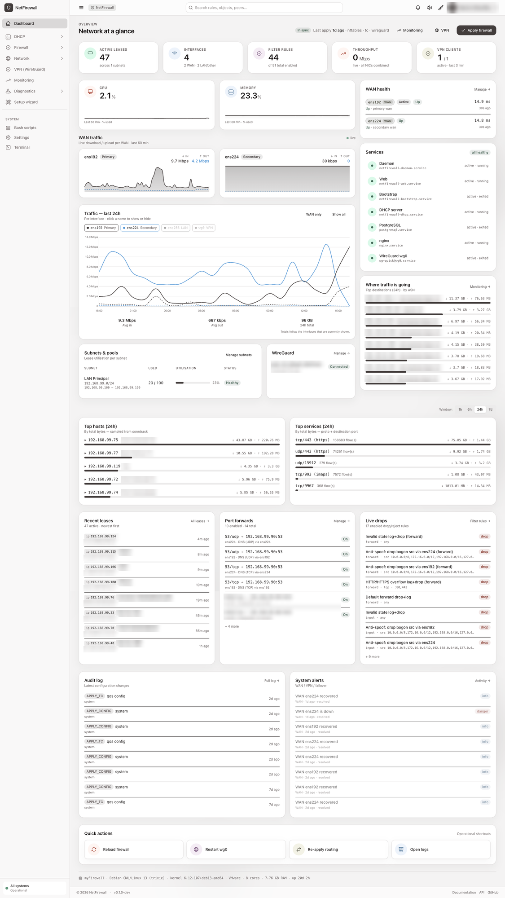
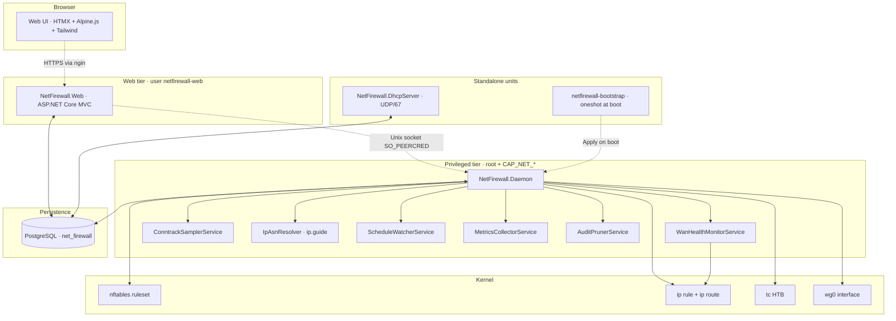
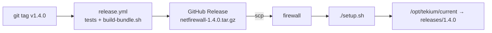
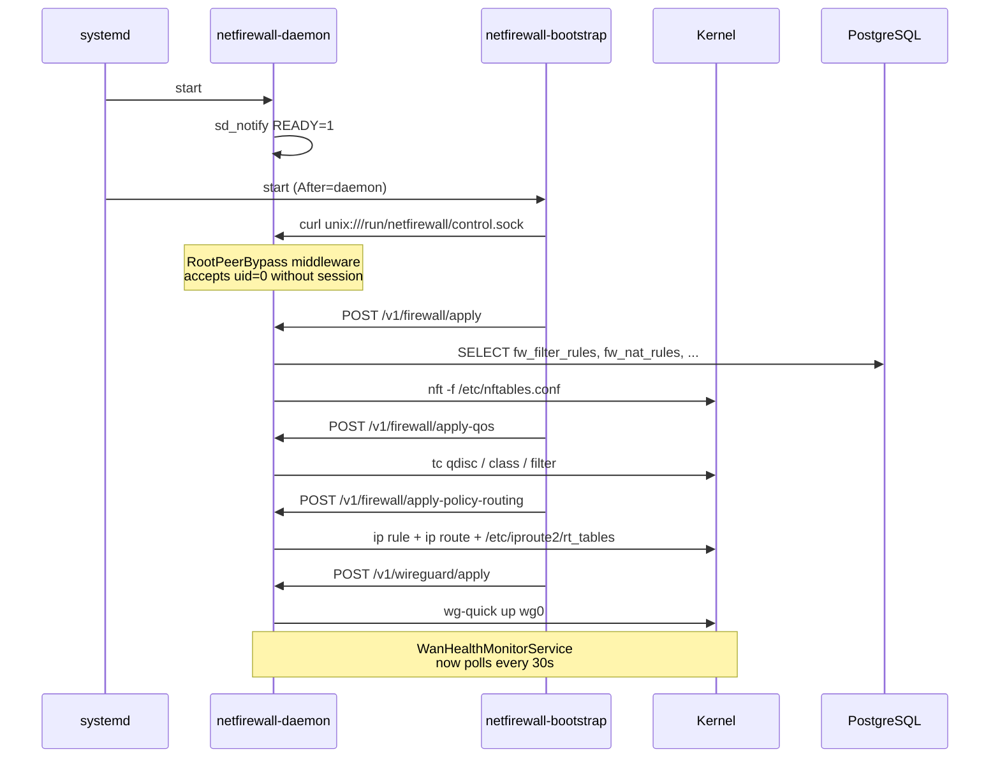
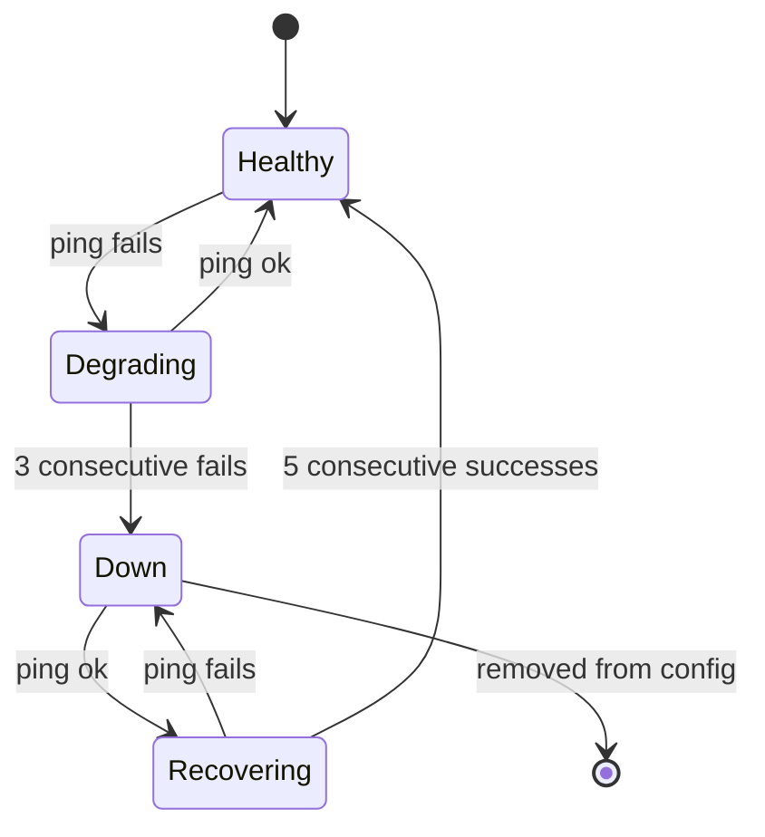

<div align="center">

🇺🇸 **English** · [🇪🇸 Español](README.es.md)

# 🛡️ NetFirewall

**A modern, self-hosted, single-pane firewall built from scratch in C# / .NET 10**

[](https://dotnet.microsoft.com/)
[](https://www.postgresql.org/)
[](https://repodb.net/)
[](https://wiki.nftables.org/)
[](LICENSE.txt)
[]()

nftables · DHCP · WireGuard · dual-WAN failover · QoS · policy routing — all driven from one database, applied by one daemon, managed from one Web UI.

</div>

---

## 📸 Dashboard



Single overview pane, updated live over HTMX without page reloads (sensitive values blurred in the screenshot):

- **Sync bar** — ruleset state (`In sync` / pending changes), time of the last apply and the subsystems it touched (nftables · tc · wireguard), with a one-click **Apply firewall**.
- **KPI cards** — active leases, interfaces (WAN vs LAN), enabled filter rules, live throughput across every NIC, connected VPN clients.
- **Server strip** — CPU, memory, load, disk and network of the firewall host over the last 5 minutes as dot-matrix charts, refreshed every 5 s from an in-memory `/proc` sampler (no database round-trip). Click through to **Monitoring → Server**.
- **WAN traffic** — live download/upload per uplink (primary / secondary), plus **Traffic — last 24h** per interface with WAN-only / show-all toggles (real Internet in/out, no NAT double-count).
- **WAN health · Services** — per-uplink reachability and latency (the same card the failover page uses) and systemd health of daemon, web, bootstrap, DHCP, PostgreSQL, nginx and `wg-quick@wg0`.
- **Where traffic is going** — busiest destinations across the LAN **enriched with ASN / organisation / country**.
- **Top hosts / Top services** — conntrack-sampled byte totals over a 1h / 6h / 24h / 7d window, with a per-host **destination drill-down**.
- **Subnets & pools · WireGuard** — lease utilisation per subnet and tunnel/peer handshake state.
- **Recent leases · Port forwards · Live drops** — newest DHCP leases, active DNAT rules and the enabled drop/reject rules.
- **Audit log · System alerts** — latest configuration changes and WAN / VPN / failover events.
- **Quick actions** — reload firewall, restart `wg0`, re-apply routing, open logs — and a **host-facts footer** (OS, kernel, virtualization, CPU cores, RAM, uptime).

## ✨ What it does

| Module | What you get |
|---|---|
| 🛡️ **Firewall** | Native nftables ruleset generated from DB — filter rules, NAT, port forwards, mangle, traffic marks. Apply with one click; backups taken before every push. |
| 📡 **DHCP server** | Pure-C# RFC 2131 server with PXE boot, subnets/pools/exclusions/MAC reservations/DDNS, AF_PACKET raw sockets for zero-IP DISCOVER handling. |
| 🌐 **Dual-WAN failover** | Daemon-side health monitor pings each WAN via fwmark policy routing (so probes hit the right link), with hysteresis (3 fails → down, 5 succ → up). Automatic default route swap when winner changes. |
| 🔐 **WireGuard VPN** | Per-peer roles — upstream tunnel, road-warrior client, site-to-site — on one interface. Import existing `/etc/wireguard/*.conf` into the DB; tunnel-down detection with hysteresis, UI banner and optional SMTP alerts. |
| 📊 **QoS (tc HTB)** | Hierarchical Token Bucket per interface with per-traffic-mark class shares. |
| 🛣️ **Policy routing** | `fw_route_tables` + `fw_policy_rules` model `ip rule` + `ip route` declaratively. The daemon reconciles `/etc/iproute2/rt_tables` + kernel state. |
| 📈 **Monitoring** | systemd service health, WAN reachability, WAN-only traffic graphs (no NAT double-count), pending-changes detector — plus **Monitoring → Server**: a host monitor that samples `/proc` every second into memory (last hour, a few hundred KB, ~µs per sample) and shows CPU (user / system / I/O wait), memory, load, disk and NIC throughput as dot matrices over 1m / 5m / 15m / 1h, the busiest programs and local filesystems. |
| 🌍 **Per-destination traffic** | conntrack sampler records *where* each LAN host's traffic goes (top-N destinations per host), enriched with ASN/org/country via [ip.guide](https://ip.guide) (cached by prefix). Drill into any host to see its destinations. |
| 🩺 **Diagnostics** | Ping by fwmark, route oracle, conntrack lookup, drop log, interface health, sysctl sanity — plus **four doctors** (VPN, WAN, DHCP, DNS), a **flow inspector** (temporary trace table, always cleaned up), bounded **tcpdump capture** and a per-WAN **speed test** pinned by `SO_MARK`. Every run is recorded in history. |
| ⏰ **Wake-on-LAN** | Saved devices (joined to DHCP by MAC), wake one / selected / all; the daemon sends the magic packet bound to the right LAN link. Wake buttons on DHCP reservations and leases too. |
| 🧙 **Setup wizard** | Starting rule set generator — Gateway / Router / Bastion archetype + capability toggles → default-deny rules built on named network objects. Idempotent. |
| 💻 **Web terminal** | Admin-only root shell in the browser (xterm.js over a PTY in the daemon), gated by TOTP. |
| 🖥️ **TUI + Doctor** | `netfirewall-tui` for console admin and break-glass recovery (reset password / TOTP / lockout); `netfirewall-doctor` validates env, master-key sync, units, socket, DHCP and PostgreSQL (`--json` for CI). |
| 👤 **Auth** | Custom session cookies, TOTP enrollment + recovery codes, elevation gates for destructive ops, comprehensive audit log. |

## 🏗️ Architecture



The daemon owns every privileged kernel mutation. The Web is sandboxed (no caps), and talks to the daemon over a Unix socket gated by `SO_PEERCRED` + session token. Persistent config lives in PostgreSQL; the kernel is just a derived view that the daemon reconciles on demand.

## ⚙️ Components

```
NetFirewall/
├── NetFirewall.Daemon           # Privileged HTTP-on-Unix-socket — every kernel mutation goes here
├── NetFirewall.Web              # ASP.NET Core MVC — HTMX + Alpine.js + Tailwind 4
├── NetFirewall.DhcpServer       # RFC 2131 + PXE — independent systemd unit
├── NetFirewall.Tui              # Spectre.Console TUI for break-glass admin
├── NetFirewall.Doctor           # Requirements validator (netfirewall-doctor)
├── NetFirewall.Services         # Business logic + Npgsql + sql/migrations/
├── NetFirewall.Models           # POCOs (DHCP, Firewall, Vpn, WanMonitor, Auth)
├── NetFirewall.Migrations       # Forward-only SQL migration runner
├── NetFirewall.Benchmarks       # BenchmarkDotNet hot-path validation
├── NetFirewall.Tests            # xUnit + Aspire.Hosting.Testing
└── deploy/
    ├── build-bundle.sh          # Builds the release tar.gz (dev box / CI)
    ├── setup.sh                 # Installs + upgrades + rolls back, on the firewall
    ├── uninstall.sh             # Reverse setup (keeps data unless --purge)
    ├── systemd/                 # Hardened unit files (@PREFIX@ rendered by setup.sh)
    ├── bootstrap/               # netfirewall-bootstrap boot-apply script
    ├── nginx/                   # TLS site (self-signed on fresh installs) + LE example
    └── seeds/                   # Per-deployment seed SQL
```

## 🚀 Quick start

NetFirewall ships as a **release bundle** — one `tar.gz` with every binary
published self-contained (the .NET runtime travels inside it), the SQL
migrations, the systemd units and `setup.sh`, which **installs a new firewall
and upgrades a running one**. Every `v*` tag publishes a bundle to
[GitHub Releases](https://github.com/mchinchilla/NetFirewall/releases); the
version and the exact commit are tracked automatically.



### Requirements (on the firewall)

- 🐧 Debian 12/13 or Ubuntu 22.04+ · x86_64 · systemd · root
- That's it — **no .NET SDK or runtime**. `setup.sh` apt-installs what's missing:
  PostgreSQL 18+ when the DB is local, nginx on fresh installs, `nftables`,
  `iproute2`, `conntrack`, `wireguard-tools`, `tcpdump`, …

### Install

```bash
# grab the bundle from GitHub Releases (or build one: deploy/build-bundle.sh)
tar xzf netfirewall-1.4.0.tar.gz && cd netfirewall-1.4.0

./setup.sh --preflight      # check host, bundle, disk and DB — changes nothing
./setup.sh                  # install
```

A fresh install creates a local PostgreSQL role + database (random password),
generates the AES-256 TOTP master key (identical in `daemon.env` and `web.env` —
**back it up**, it is printed once), configures nginx with a self-signed
certificate, starts the daemon + Web and runs `netfirewall-doctor`. Then:

```bash
journalctl -u netfirewall-web | grep -i bootstrap   # one-time link for the first admin
```

Common variations:

```bash
./setup.sh --with-dhcp --dhcp-iface ens256                 # also serve DHCP (UDP/67)
./setup.sh --db-host 10.0.0.5 --db-password 'S3cret'       # remote PostgreSQL
./setup.sh --tls-cert fullchain.pem --tls-key privkey.pem  # real certificate
./setup.sh --skip-nginx --yes                              # own proxy, unattended
```

### Upgrade

```bash
tar xzf netfirewall-1.5.0.tar.gz && cd netfirewall-1.5.0
./setup.sh                  # options are remembered in /etc/netfirewall/setup.conf
```

Each upgrade: **pg_dump backup** → stage `releases/1.5.0` → **migrate with the new
binaries before switching** → flip the `current` symlink → restart → health-check
(the daemon must report the new version on `/health`). If the daemon or the Web
don't come back, it **rolls back automatically**. Master key, DB password and
hand edits to the env files are preserved; the live nftables ruleset and the
network config are never touched.

### Rollback

```bash
./setup.sh --list-releases         # ● active  ↩ previous
./setup.sh --rollback              # back to the previous release (seconds)
./setup.sh --rollback 1.4.0        # or to a specific one still on disk
```

The schema is **not** rolled back (migrations are forward-only); each upgrade's
dump in `/var/backups/netfirewall/` is the way back from a destructive migration.

**📘 Every option, every step, the on-disk layout and the failure modes:
[`docs/setup.md`](docs/setup.md)** (also covers moving a host from the old
`install.sh` layout).

### Build a bundle yourself

```bash
deploy/build-bundle.sh                    # → dist/netfirewall-<git describe>.tar.gz
deploy/build-bundle.sh --version 1.5.0-rc1
```

Needs the .NET 10 SDK and the standalone `tailwindcss` binary on `PATH`. The
version comes from `git describe --tags --always --dirty` (`1.4.0`,
`1.4.0-3-g97f88aa`, `…-dirty`) and is stamped into the assemblies (login page
*System info* card, the daemon's `/health`), `VERSION` and `BUILD_INFO`.

### Kernel features

The firewall is a router: IPv4 forwarding must be on, and the dashboard's
top-talkers panel needs conntrack byte accounting (`conntrack -L` only emits
`bytes=` when `nf_conntrack_acct=1`). `setup.sh` installs
`/etc/sysctl.d/netfirewall.conf` plus the modprobe/modules-load drop-ins that make
`nf_conntrack_acct` survive reboots, but **forwarding is your call**:

```bash
echo 'net.ipv4.ip_forward = 1' > /etc/sysctl.d/99-netfirewall-router.conf
sysctl --system
sysctl net.ipv4.ip_forward net.netfilter.nf_conntrack_acct
```

> **Policy routing + `rp_filter`:** strict reverse-path filtering
> (`net.ipv4.conf.*.rp_filter=1`) silently drops fwmark-routed traffic whose
> reply path differs from its inbound interface. If marked traffic refuses to
> leave the intended WAN/VPN even though `ip rule` + the route table look
> correct, loosen it: `sysctl -w net.ipv4.conf.all.rp_filter=2` (loose mode).
> See diagnostics below.

### Verify

```bash
netfirewall-doctor                    # env, master-key sync, release, units, socket, DB
systemctl status 'netfirewall-*'
cat /opt/tekium/current/BUILD_INFO    # exact version + commit in production
```

## 🔄 Boot-time apply workflow



## 🌐 Dual-WAN failover

The daemon's `WanHealthMonitorService` runs every 30s by default. For each enabled `wan_health_config` row:

1. **Probe** — `ping -m <fwmark>` to every monitor target. The fwmark forces the kernel to honor `ip rule fwmark X lookup wanN`, so the probe pins to the WAN being tested even when the main table points elsewhere.
2. **Hysteresis** — 3 consecutive failures flip the WAN to `is_up=false`; 5 consecutive successes flip it back.
3. **Reconcile** — lowest-priority healthy WAN wins. If the winner changed, `ip route replace default via <gw> dev <iface>` in the main table.
4. **Audit** — `wan_health_events` records every transition; `fw_apply_history` registers each failover.



## 🗄️ Database schema (42 migrations)

| Range | Domain |
|---|---|
| `00001–00004` | Extensions + firewall core (interfaces, filter/NAT/mangle rules, traffic marks, static routes, QoS, audit log) |
| `00005–00010` | DHCP (legacy + subnets + pools + options + relay + failover + DDNS + setup wizard) |
| `00011` | Auth (users, sessions, TOTP secrets, auth audit log) |
| `00012–00013` | System metrics + app settings |
| `00014, 00021` | WireGuard (servers, peers, modes) |
| `00015–00020` | Network objects, FQDN sets, user profile, search index, schedules, services |
| `00022` | Apply history (per-kind drift detection) |
| `00023` | Policy routing (named tables + fwmark rules) |
| `00024` | LAN traffic samples (conntrack-fed top talkers) |
| `00025–00026` | WAN health + probe fwmark |
| `00027–00029` | Per-destination traffic, ASN cache, network metrics |
| `00030–00031` | Global search index (DHCP + firewall) |
| `00032–00033, 00036–00037` | WireGuard route modes, VPN health monitor, peer roles (upstream / client / site) |
| `00034–00035` | WAN health auto-seed + manual active-WAN override |
| `00038–00040` | DHCP lease-delete notify, schedule inversion, orphan cleanup |
| `00041` | Diagnostics run history (`diag_runs`) |
| `00042` | Wake-on-LAN devices |

Forward-only; `__migrations` table tracks SHA-256 of every applied file to detect drift.

## 🔐 Hardening

- **Privilege separation** — Daemon runs as root with `CapabilityBoundingSet=CAP_NET_ADMIN CAP_DAC_OVERRIDE CAP_NET_RAW CAP_CHOWN`. Web runs as unprivileged `netfirewall-web`. Bootstrap is a one-shot that calls the daemon over Unix socket.
- **Systemd sandbox** — `ProtectSystem=strict`, `ProtectKernelTunables/Modules/Logs`, `RestrictAddressFamilies` (carefully tuned per-service: AF_PACKET for DHCP, AF_NETLINK for daemon), `SystemCallFilter=@system-service` minus `@mount @swap @reboot @raw-io`.
- **Auth flow** — Session cookie issued only over HTTPS, TOTP required for first login, **elevation** gate (re-prompt TOTP) for destructive endpoints (`apply firewall`, `update interface`, etc.).
- **TOTP encryption** — master key lives only inside the daemon (loaded from `/etc/netfirewall/daemon.env`). The Web posts to `POST /v1/crypto/encrypt|decrypt` over the Unix socket — a Web compromise can't decrypt stored secrets.

## 🛠️ Operations

### Manual apply via curl (root peer bypass)

```bash
SOCK=/run/netfirewall/control.sock
curl --unix-socket "$SOCK" -X POST http://daemon/v1/firewall/apply
curl --unix-socket "$SOCK" -X POST http://daemon/v1/firewall/apply-qos
curl --unix-socket "$SOCK" -X POST http://daemon/v1/firewall/apply-policy-routing
curl --unix-socket "$SOCK" -X POST http://daemon/v1/wireguard/apply
```

### Ship a code change

Editing source changes **nothing** in the kernel until a new release is running
and re-applied. Tag it (or take the `master` bundle artifact of the *Release
bundle* workflow), then on the firewall:

```bash
tar xzf netfirewall-1.5.1.tar.gz && cd netfirewall-1.5.1 && ./setup.sh
# then: UI → Firewall → Apply (TOTP), or the "Manual apply via curl" above
```

### Diagnostics

When something "is configured but doesn't work," walk the chain from the kernel
down. All read-only — safe to run on a live box.

**Services & sockets**

```bash
systemctl status netfirewall-daemon netfirewall-web
journalctl -u netfirewall-daemon -n 100 --no-pager     # daemon log
journalctl -u netfirewall-web    -n 100 --no-pager     # web log
ls -l /run/netfirewall/control.sock                    # daemon Unix socket (0660 root:netfirewall)
curl --unix-socket /run/netfirewall/control.sock http://daemon/v1/health   # ping the daemon
```

**nftables — is the ruleset what you expect?**

```bash
nft list ruleset                       # everything
nft list table ip filter               # filter chains
nft list table ip nat                  # DNAT / masquerade
nft list table ip mangle               # fwmark marking (policy routing)
nft -c -f /etc/nftables.conf           # validate the generated file WITHOUT applying
```

> Mangle gotcha: each marking rule must end in `... meta mark set 0xNNN return`.
> `meta mark set` is **not** terminal — without `return`, a later broad rule
> (e.g. `192.168.99.0/24 → WAN1`) overwrites the mark of a specific host above
> it, and that host silently leaves via the wrong link.

**Policy routing — does the mark reach the right table & device?**

```bash
ip rule show                                       # fwmark → table mappings
ip route show table all | grep -i wg0              # routes per table
ip route show table wg0                            # one named table (or: table <id>)
cat /etc/iproute2/rt_tables                         # table-name registrations

# THE definitive test: which device would a marked packet from host X use?
ip route get 8.8.8.8 from 192.168.99.66 mark 0x500   # expect: dev wg0
```

**Connection tracking / top talkers (dashboard panel empty)**

```bash
# the binary must exist (Debian: conntrack · RHEL/SUSE: conntrack-tools)
which conntrack || apt install -y conntrack
which conntrack && conntrack -V

# byte accounting MUST be 1, otherwise `bytes=` is absent and the panel stays empty
sysctl net.netfilter.nf_conntrack_acct
sysctl -w net.netfilter.nf_conntrack_acct=1          # enable live if it's 0

# are there flows, and do they carry bytes=?
conntrack -L -o extended 2>/dev/null | head -5
conntrack -L -o extended 2>/dev/null | wc -l
conntrack -L -o extended 2>/dev/null | head -3 | grep -o "bytes=[0-9]*"
conntrack -L -s 192.168.99.66 2>/dev/null | head     # flows from one source

# is the daemon's sampler reading conntrack?
journalctl -u netfirewall-daemon --since "10 min ago" | grep -i "conntrack\|sampler\|lan_traffic"
```

**WireGuard**

```bash
wg show                                  # peers, handshakes, transfer
wg show wg0 allowed-ips                  # what each peer is allowed to route
ip -br addr show wg0                      # interface up + address
wg-quick up wg0                          # bring up manually (daemon normally does this)
```

**WAN / forwarding**

```bash
sysctl net.ipv4.ip_forward                          # must be 1 for a router
ping -m 256 -c2 1.1.1.1                              # test a WAN by its probe fwmark (-I is ignored by policy routing)
ip route show default                               # current default route
```

**Apply history & audit (DB)**

```sql
SELECT kind, success, applied_at, applied_by, message
FROM fw_apply_history ORDER BY applied_at DESC LIMIT 20;
```

### Migrations

```bash
bin/db.sh status   # what's applied / pending / drifted
bin/db.sh up       # apply pending
bin/db.sh seed     # apply demo seed (DEV ONLY)
```

### Tail audit + apply history

```sql
SELECT event_type, username, ip, occurred_at FROM auth_audit_log ORDER BY occurred_at DESC LIMIT 20;
SELECT kind, success, applied_at, applied_by, message FROM fw_apply_history ORDER BY applied_at DESC LIMIT 20;
```

## ⚠️ Deprecated

These artifacts are kept in the repo for reference but no longer active in production:

| Item | Replaced by | Notes |
|---|---|---|
| `/root/firewall.sh` (or `Bash/firewall.sh`) | `netfirewall-bootstrap.service` + DB-driven `fw_policy_rules` + `fw_route_tables` | Old script issued `ip rule add` and `ip route add` directly; now reconciled by `IPolicyRoutingApplyService` from DB. |
| `NetFirewall.WanMonitor` (standalone process) | `WanHealthMonitorService` (HostedService inside the daemon) | Old monitor shelled out and had no DB state. New one persists `wan_health_state` + `wan_health_events`. |
| `netfirewall-wanmonitor.service` | (none — absorbed into daemon) | Disable + remove if upgrading from a pre-2026-05 deployment. |
| `BashCommandsConfig.Extra{Primary,Secondary}Commands` | Daemon-driven Apply endpoints | Old WanMonitor invoked these bash lists on failover; daemon now does the equivalent declaratively. |
| `deploy/install.sh` (compiled on the server) | Release bundle + `setup.sh` | Needed the .NET SDK on the firewall; no versioning, no rollback. |
| Appliance `.deb` + Debian 13 ISO | Release bundle + `setup.sh` | Hard to upgrade on a running firewall; removed. |

## 📖 Docs

- [`docs/DEPLOY_HANDOFF.md`](docs/DEPLOY_HANDOFF.md) — current deployment state + handoff notes
- [`docs/PerformanceAnalysis.md`](docs/PerformanceAnalysis.md) — DHCP hot path budget + zero-allocation rules
- [`docs/DHCP_FEATURE_COMPARISON.md`](docs/DHCP_FEATURE_COMPARISON.md) — feature parity vs isc-dhcp / kea
- [`docs/diagnostics.md`](docs/diagnostics.md) — Diagnostics section: tools, doctors, history, safety rules
- [`docs/setup.md`](docs/setup.md) — release bundle, every `setup.sh` option, upgrades, rollback
- [`docs/doctor.md`](docs/doctor.md) — `netfirewall-doctor` checks and remedies
- [`docs/master-key.md`](docs/master-key.md) — TOTP master key: location, daemon ↔ Web sync rule
- [`docs/wake-on-lan.md`](docs/wake-on-lan.md) — Wake-on-LAN design and usage
- [`CLAUDE.md`](CLAUDE.md) — project rules (non-negotiable)

## 📜 License

MIT — see [LICENSE.txt](LICENSE.txt).

---

<div align="center">

**Built with ❤️ in C# / .NET 10 · Powered by PostgreSQL + RepoDB + nftables**

</div>
