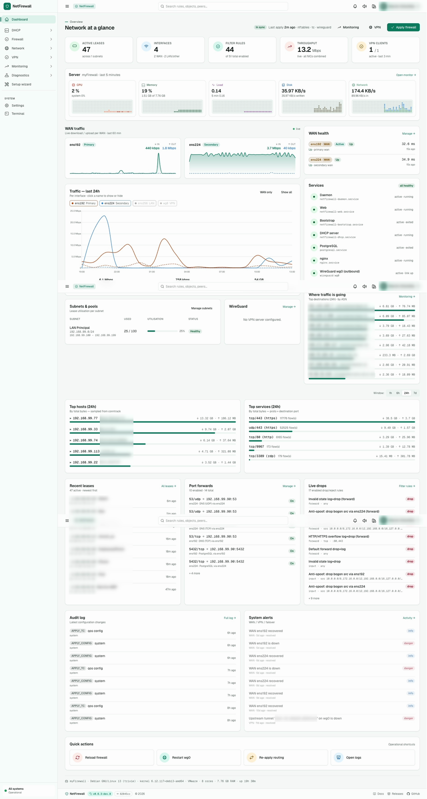
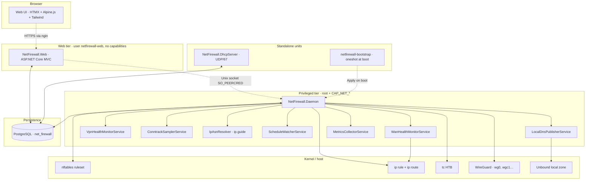
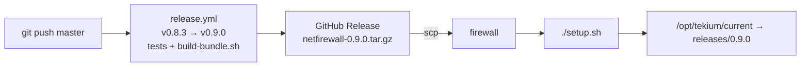
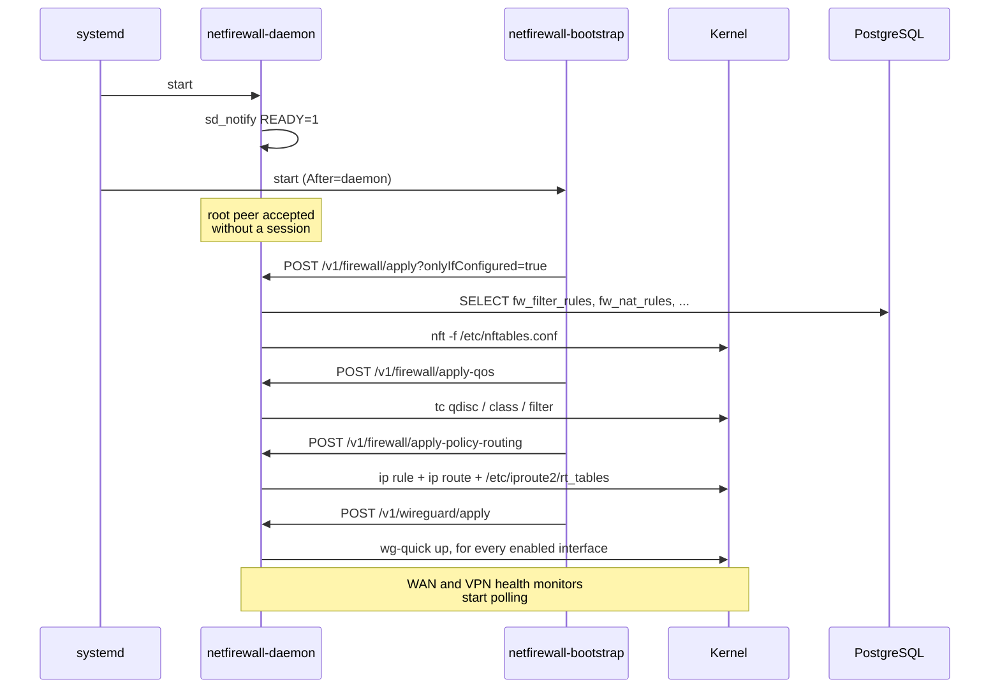
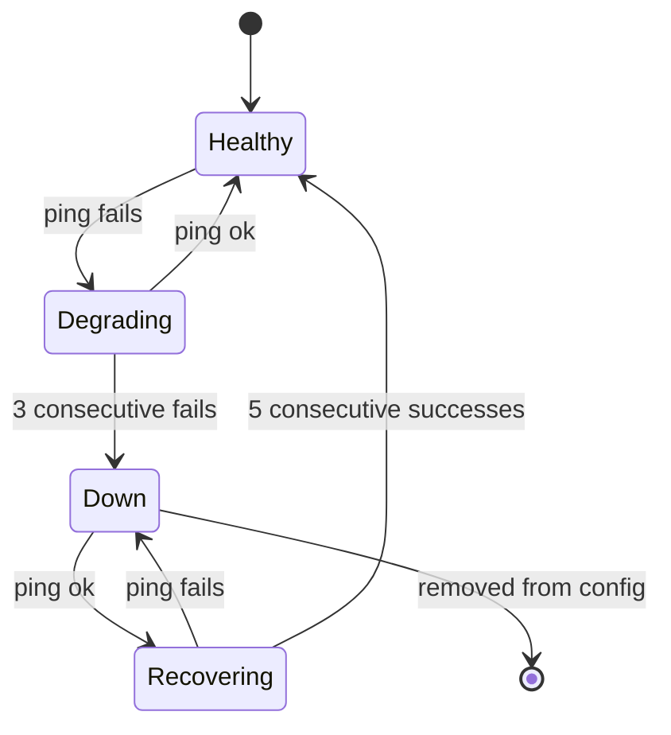
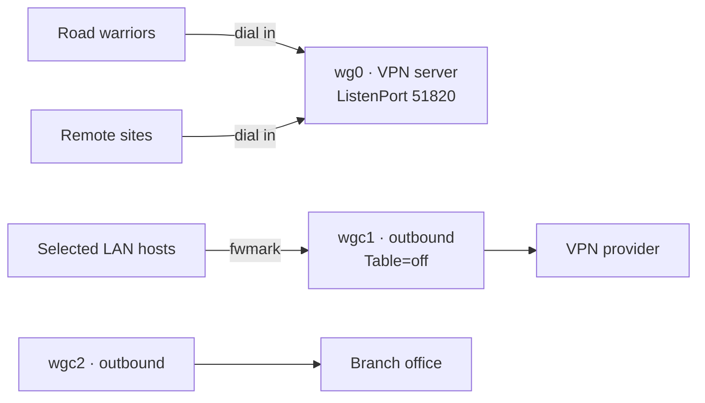

<div align="center">

🇺🇸 **English** · [🇪🇸 Español](README.es.md)

# 🛡️ NetFirewall

**A modern, self-hosted, single-pane firewall built from scratch in C# / .NET 11**

[](https://dotnet.microsoft.com/)
[](https://www.postgresql.org/)
[](https://repodb.net/)
[](https://wiki.nftables.org/)
[](LICENSE.txt)
[]()

nftables · DHCP · WireGuard · dual-WAN failover · QoS · policy routing · diagnostics: all driven from one database, applied by one daemon and managed from one Web UI.

</div>

---

## 📸 Dashboard



A single overview page, updated live over HTMX without page reloads. Personal names, device names, MAC addresses and public destinations are blurred in the screenshot.

- **Sync bar**: whether the kernel matches the database (`In sync` or pending changes), when the last apply ran and what it touched (nftables · tc · wireguard), with a one-click **Apply firewall**.
- **KPI cards**: active leases, interfaces (WAN vs LAN), enabled filter rules, live throughput across every NIC, connected VPN clients.
- **Server strip**: CPU, memory, load, disk and network of the firewall host over the last 5 minutes as dot-matrix charts, refreshed every 5 s from an in-memory `/proc` sampler (no database round trip). Opens **Monitoring → Server**.
- **WAN traffic**: live download/upload per uplink (primary / secondary), plus **Traffic, last 24h** per interface with a WAN-only / show-all toggle (real Internet in/out, no NAT double count).
- **WAN health · Services**: reachability and latency per uplink (the same card the failover page uses), and the health of the daemon, Web, bootstrap, DHCP server, PostgreSQL, nginx and **every WireGuard interface by its link state**.
- **Where traffic is going**: the busiest destinations of the LAN, **with ASN, organisation and country**.
- **Top hosts / Top services**: conntrack-sampled byte totals over 1h / 6h / 24h / 7d, with a **destination drill-down** per host.
- **Subnets & pools · WireGuard**: lease utilisation per subnet, and the VPN server's peers and handshakes.
- **Recent leases · Port forwards · Live drops**: newest DHCP leases, active DNAT rules and the enabled drop/reject rules.
- **Audit log · System alerts**: latest configuration changes, and WAN / VPN / DHCP events (failover, tunnel down, pool nearly full, rogue DHCP server).
- **Quick actions** (reload firewall, restart a tunnel, re-apply routing, open logs) and a **host-facts footer** (OS, kernel, virtualization, CPU cores, RAM, uptime).

## ✨ What it does

| Module | What you get |
|---|---|
| 🛡️ **Firewall** | Native nftables ruleset generated from the database: filter rules, NAT, port forwards, mangle, traffic marks, time schedules (including "block outside this window"), named network objects and FQDN sets. One-click apply with a backup before every push. Rules whose objects resolve to nothing are skipped, never widened. |
| 📡 **DHCP server** | Pure C#, RFC 2131 compliant, about 0.9 µs of CPU per packet. Subnets, pools, exclusions, reservations with DNS host names, client classes (all 8 match types) with pool allow/deny, **custom options** (VoIP phones, access points, WPAD…), PXE BIOS/UEFI + iPXE chainloading, relay agents and option 82. Pings an address before offering it, holds offers, re-offers a client's current lease. Device names are published in the firewall's DNS (`ping nas.lan`), RFC 2136 DDNS runs in the background, 90-day **lease history**, alerts for an exhausted pool or a **rogue DHCP server**. AF_PACKET raw sockets per interface. |
| 🌐 **Dual-WAN failover** | The daemon pings each WAN through its own fwmark (so probes leave by the link under test), with hysteresis (3 fails → down, 5 successes → up), and swaps the default route when the winner changes. Manual override. |
| 🔐 **WireGuard VPN** | **One interface per role.** The **VPN server** (`wg0`: road warriors and sites that dial in, QR configs) and **outbound connections** (`wgc1`, `wgc2`…: a VPN provider or a remote site, created from a pasted config). Route selected LAN hosts through a tunnel, site-to-site subnets, import existing `/etc/wireguard/*.conf`. Tunnel-down detection with hysteresis, banner and optional SMTP alerts. An old `wg0` that does both jobs can be **split** with a preview and a 10-minute confirm-or-revert. |
| 📊 **QoS (tc HTB)** | Hierarchical Token Bucket per interface with class shares per traffic mark. |
| 🛣️ **Policy routing** | `fw_route_tables` + `fw_policy_rules` describe `ip rule` + `ip route` declaratively; the daemon reconciles `/etc/iproute2/rt_tables` and the kernel. |
| 📈 **Monitoring** | systemd service health, WAN reachability, WAN-only traffic graphs, a pending-changes detector, and **Monitoring → Server**: CPU (user / system / I/O wait), memory, load, disk and NIC throughput sampled every second into memory, as dot matrices over 1m / 5m / 15m / 1h, plus the busiest programs and the local filesystems. |
| 🌍 **Per-destination traffic** | The conntrack sampler records *where* each LAN host's traffic goes (top N destinations per host), with ASN / organisation / country from [ip.guide](https://ip.guide), cached by prefix. |
| 🩺 **Diagnostics** | Ping by fwmark, route oracle, conntrack lookup, drop log, interface health, sysctl sanity; **four doctors** (VPN, WAN, DHCP, DNS); a **flow inspector** (temporary trace table, always cleaned up); bounded **tcpdump capture**; and a per-WAN **speed test** pinned by `SO_MARK`. Every run is kept in history. |
| ⏰ **Wake-on-LAN** | Saved devices (joined to DHCP by MAC); wake one, the selected ones or all. The daemon sends the magic packet bound to the right LAN link. Wake buttons on DHCP reservations and leases too. |
| 🧙 **Setup wizard** | Starting rule set: Gateway / Router / Bastion plus capability toggles → default-deny rules built on named network objects. Idempotent. |
| 💻 **Web terminal** | Admin-only root shell in the browser (xterm.js over a PTY in the daemon), gated by TOTP. |
| 🖥️ **TUI + Doctor** | `netfirewall-tui` for console administration and break-glass recovery (reset password / TOTP / lockout); `netfirewall-doctor` validates env files, master-key sync, release, units, socket, DHCP and PostgreSQL (`--json` for CI). |
| 👤 **Auth** | Session cookies, TOTP enrollment + recovery codes, re-prompt (elevation) before destructive operations, full audit log. |
| 🎨 **UI** | Sortable, filterable, exportable data grids ([NetOpenGrid](https://github.com/mchinchilla/NetOpenGrid)) with row details; light / dark / system themes with 8 accent colours and two densities; global search. Every client library (HTMX, Alpine.js, Chart.js, xterm.js, fonts) is **vendored and served by the firewall**: the UI never loads anything from the Internet. |

## 🏗️ Architecture



The daemon owns every privileged change to the kernel. The Web is sandboxed (no capabilities) and talks to the daemon over a Unix socket gated by `SO_PEERCRED` plus a session token. Configuration lives in PostgreSQL; the kernel state is derived from it, and the daemon reconciles it on demand.

## ⚙️ Components

```
NetFirewall/
├── NetFirewall.Daemon           # Privileged HTTP on a Unix socket: every kernel change goes through here
├── NetFirewall.Web              # ASP.NET Core MVC: HTMX + Alpine.js + Tailwind 4 + NetOpenGrid
├── NetFirewall.DhcpServer       # RFC 2131 DHCP + PXE, its own systemd unit
├── NetFirewall.Tui              # Spectre.Console TUI for console and break-glass administration
├── NetFirewall.Doctor           # Requirements validator (netfirewall-doctor)
├── NetFirewall.Services         # Business logic + Npgsql/RepoDB + sql/migrations/
├── NetFirewall.Models           # POCOs (DHCP, Firewall, Vpn, Wol, System, Auth)
├── NetFirewall.Migrations       # Forward-only SQL migration runner (netfirewall-migrate)
├── NetFirewall.Benchmarks       # BenchmarkDotNet: DHCP packet path and lease writes
├── NetFirewall.Tests            # xUnit + Moq, ~1900 tests, many against a real PostgreSQL
├── NetFirewall.AppHost          # .NET Aspire dev orchestration
└── deploy/
    ├── build-bundle.sh          # Builds the release tar.gz (dev box / CI)
    ├── setup.sh                 # Installs, upgrades and rolls back, on the firewall
    ├── uninstall.sh             # Reverse of setup (keeps data unless --purge)
    ├── systemd/                 # Hardened unit files (@PREFIX@ rendered by setup.sh)
    ├── bootstrap/               # netfirewall-bootstrap boot-time apply script
    ├── nginx/                   # TLS site (self-signed on fresh installs) + Let's Encrypt example
    ├── pgdg/                    # Signing key of the official PostgreSQL apt repository
    └── seeds/                   # Per-deployment seed SQL
```

## 🚀 Quick start

NetFirewall ships as a **release bundle**: one `tar.gz` with every binary
published self-contained (the .NET runtime travels inside it), the SQL
migrations, the systemd units and `setup.sh`, which **installs a new firewall
and upgrades a running one**. **Every push to `master` publishes the next
version** to [GitHub Releases](https://github.com/mchinchilla/NetFirewall/releases)
automatically (patch by default, `[minor]` / `[major]` in the commit message to
bump more, `[skip release]` to skip), and every bundle records its exact commit.



### Requirements (on the firewall)

- 🐧 Debian 12/13 or Ubuntu 22.04+ · x86_64 (or arm64 with `--rid linux-arm64`) · systemd · root
- **No .NET SDK or runtime.** `setup.sh` apt-installs what's missing:
  **PostgreSQL 19 from the official repository** (apt.postgresql.org, signing key
  shipped in the bundle) when the database is local, nginx on fresh installs,
  `nftables`, `iproute2`, `conntrack`, `wireguard-tools`, `tcpdump`, …
  An already-installed PostgreSQL is kept as is, never upgraded or duplicated.

### Install

```bash
# grab the bundle from GitHub Releases (or build one: deploy/build-bundle.sh)
tar xzf netfirewall-0.9.0.tar.gz && cd netfirewall-0.9.0

./setup.sh --preflight      # checks host, bundle, disk and database; changes nothing
./setup.sh                  # install
```

A fresh install creates a local PostgreSQL role and database (random password),
generates the AES-256 TOTP master key (identical in `daemon.env` and `web.env`;
**back it up**, it is printed once), configures nginx with a self-signed
certificate, starts the daemon and the Web, and runs `netfirewall-doctor`. Then:

```bash
journalctl -u netfirewall-web | grep -i bootstrap   # one-time link for the first admin
```

Common variations:

```bash
./setup.sh --with-dhcp --dhcp-iface ens256                 # also serve DHCP (UDP/67)
./setup.sh --db-host 10.0.0.5 --db-password 'S3cret'       # remote PostgreSQL
./setup.sh --pg-version 18                                 # another major (--no-pgdg: the distro's)
./setup.sh --tls-cert fullchain.pem --tls-key privkey.pem  # real certificate
./setup.sh --skip-nginx --yes                              # your own proxy, unattended
```

> If you bring your own nginx, it must send `X-Frame-Options SAMEORIGIN`
> (not `DENY`): the data grids are same-origin iframes. `netfirewall-doctor` warns about it.

### Upgrade

```bash
tar xzf netfirewall-0.9.1.tar.gz && cd netfirewall-0.9.1
./setup.sh                  # options are remembered in /etc/netfirewall/setup.conf
```

Each upgrade: **pg_dump backup** → stage `releases/<version>` → **migrate with the new
binaries before switching** → flip the `current` symlink → restart → health check
(the daemon must report the new version on `/health`). If the daemon or the Web
don't come back, it **rolls back automatically**. The master key, the database
password and hand edits to the env files are preserved; the live nftables ruleset,
routes, WireGuard and network configuration are never touched.

### Rollback

```bash
./setup.sh --list-releases         # ● active  ↩ previous
./setup.sh --rollback              # back to the previous release (seconds)
./setup.sh --rollback 0.8.3        # or to a specific one still on disk
```

The schema is **not** rolled back (migrations are forward-only); the dump each
upgrade leaves in `/var/backups/netfirewall/` is the way back from a destructive migration.

**📘 Every option, every step, the on-disk layout and the failure modes:
[`docs/setup.md`](docs/setup.md)** (also covers moving a host from the old
`install.sh` layout, and moving an existing PostgreSQL to 19).

### Build a bundle yourself

```bash
deploy/build-bundle.sh                     # → dist/netfirewall-<git describe>.tar.gz
deploy/build-bundle.sh --version 1.0.0-rc1
deploy/build-bundle.sh --rid linux-arm64   # ARM appliances
```

Needs the .NET 11 SDK and the standalone `tailwindcss` binary on `PATH` (no npm,
ever). The version comes from `git describe` and is stamped into the assemblies
(login page *System info*, the daemon's `/health`), `VERSION` and `BUILD_INFO`.
A plain `dotnet build` is stamped too: `0.9.0` on a clean tag, otherwise
`0.9.1-dev.<commits>[-dirty]`.

### Develop

```bash
dotnet build                                          # also compiles Tailwind
dotnet test                                           # needs a local PostgreSQL for the DB tests
dotnet run --project NetFirewall.Migrations -- up     # apply pending migrations to the dev DB
dotnet run --project NetFirewall.AppHost              # Aspire: Web + ApiService + DHCP server
```

### Kernel features

The firewall is a router: IPv4 forwarding must be on, and the dashboard's
top-talkers panel needs conntrack byte accounting (`conntrack -L` only emits
`bytes=` when `nf_conntrack_acct=1`). `setup.sh` installs
`/etc/sysctl.d/netfirewall.conf` plus the modprobe / modules-load drop-ins that make
`nf_conntrack_acct` survive reboots, but **forwarding is your call**:

```bash
echo 'net.ipv4.ip_forward = 1' > /etc/sysctl.d/99-netfirewall-router.conf
sysctl --system
sysctl net.ipv4.ip_forward net.netfilter.nf_conntrack_acct
```

> **Policy routing + `rp_filter`:** strict reverse-path filtering
> (`net.ipv4.conf.*.rp_filter=1`) silently drops fwmark-routed traffic whose
> reply path differs from its inbound interface. If marked traffic refuses to
> leave by the intended WAN/VPN although `ip rule` and the route table look
> correct, loosen it: `sysctl -w net.ipv4.conf.all.rp_filter=2` (loose mode).

### Verify

```bash
netfirewall-doctor                    # env, master-key sync, release, units, socket, DHCP, DB
systemctl status 'netfirewall-*'
cat /opt/tekium/current/BUILD_INFO    # exact version + commit in production
```

## 🔄 Boot-time apply



`onlyIfConfigured=true` means a box that has never been configured is not locked
out by an empty default-deny ruleset at boot.

## 🌐 Dual-WAN failover

The daemon's `WanHealthMonitorService` runs every 30 s by default. For each enabled `wan_health_config` row:

1. **Probe**: `ping -m <fwmark>` to every monitor target. The fwmark makes the kernel honour `ip rule fwmark X lookup wanN`, so the probe leaves by the WAN under test even when the main table points elsewhere.
2. **Hysteresis**: 3 consecutive failures mark the WAN down; 5 consecutive successes mark it up.
3. **Reconcile**: the healthy WAN with the lowest priority wins. If the winner changed: `ip route replace default via <gw> dev <iface>` in the main table.
4. **Audit**: `wan_health_events` records every transition; `fw_apply_history` records each failover.



## 🔐 WireGuard: one interface per role



- The **VPN server** accepts clients; its peers get QR / `.conf` files from the UI.
- An **outbound connection** dials somewhere else. It is created from a pasted config (script hooks such as `PostUp` are refused) and always uses `Table=off`, so it never hijacks the firewall's own default route. Traffic is sent into it by policy routing.
- An interface's role is read from its **data** (a listen port and inbound peers vs a dialled upstream), never from a label.
- **Splitting an old dual-role `wg0`**: the preview shows what moves. `wg0` stays the outbound connection and the server moves to `wg1` **with the same key and port**, so client configs keep working. You confirm within 10 minutes or it reverts by itself. Hand-written firewall rules that name `wg0` are listed for you to review.

## 🗄️ Database schema (50 migrations)

| Range | Domain |
|---|---|
| `00001–00004` | Extensions + firewall core (interfaces, filter/NAT/mangle rules, traffic marks, static routes, QoS, audit log) |
| `00005–00010` | DHCP (subnets, pools, options, relay, failover, DDNS) + setup wizard |
| `00011` | Auth (users, sessions, TOTP secrets, auth audit log) |
| `00012–00013` | System metrics + app settings |
| `00014, 00021` | WireGuard (servers, peers, modes) |
| `00015–00020` | Network objects, FQDN sets, user profile, search index, schedules, services |
| `00022` | Apply history (per-kind drift detection) |
| `00023` | Policy routing (named tables + fwmark rules) |
| `00024` | LAN traffic samples (conntrack top talkers) |
| `00025–00026` | WAN health + probe fwmark |
| `00027–00029` | Per-destination traffic, ASN cache, network metrics |
| `00030–00031` | Global search index (DHCP + firewall) |
| `00032–00033, 00036–00037` | WireGuard route modes, VPN health monitor, peer roles |
| `00034–00035` | WAN health auto-seed + manual active-WAN override |
| `00038–00040` | DHCP lease-delete notify, schedule inversion, orphan cleanup |
| `00041` | Diagnostics run history |
| `00042` | Wake-on-LAN devices |
| `00043–00044` | Dismissable system alerts, DHCP reservation notify |
| `00045` | One WireGuard interface per role (unique, link-safe names) |
| `00046–00049` | DHCP: iPXE boot file, custom options, reservation host names, lease history |
| `00050` | WireGuard split journal (confirm or revert) |

Forward-only; the `__migrations` table keeps the SHA-256 of every applied file to detect edits.

## 🔐 Hardening

- **Privilege separation**: the daemon runs as root with `CapabilityBoundingSet=CAP_NET_ADMIN CAP_DAC_OVERRIDE CAP_NET_RAW CAP_CHOWN`. The Web runs as the unprivileged `netfirewall-web` with **no capabilities**. The DHCP server only gets `CAP_NET_BIND_SERVICE CAP_NET_RAW`. Bootstrap is a oneshot that calls the daemon over the Unix socket.
- **systemd sandbox**: `ProtectSystem=strict` with tight `ReadWritePaths`, `ProtectKernelTunables/Modules/Logs`, `RestrictAddressFamilies` tuned per service (AF_PACKET for DHCP and captures, AF_NETLINK for the daemon), `SystemCallFilter=@system-service` minus `@mount @swap @reboot @raw-io @cpu-emulation`.
- **Auth flow**: session cookie over HTTPS only, TOTP required on first login, **elevation** (re-prompt TOTP) before destructive endpoints (apply firewall, change an interface, split a VPN…).
- **TOTP encryption**: the master key is used only inside the daemon (`/etc/netfirewall/daemon.env`); the Web asks it to encrypt/decrypt over the Unix socket, so a compromised Web process can't decrypt stored secrets.
- **No external assets**: every script, stylesheet and font the UI uses is vendored in the repository and served by the firewall.
- **Safe diagnostics**: tools run through validated argument lists (never a shell string; enforced by a test), one invasive tool at a time, with time and size limits.

## 🛠️ Operations

### Manual apply via curl (as root)

```bash
SOCK=/run/netfirewall/control.sock
curl --unix-socket "$SOCK" -X POST http://daemon/v1/firewall/apply
curl --unix-socket "$SOCK" -X POST http://daemon/v1/firewall/apply-qos
curl --unix-socket "$SOCK" -X POST http://daemon/v1/firewall/apply-policy-routing
curl --unix-socket "$SOCK" -X POST http://daemon/v1/wireguard/apply             # every enabled interface
curl --unix-socket "$SOCK" -X POST "http://daemon/v1/wireguard/apply?name=wg0"  # just one
```

### Ship a code change

Editing source changes **nothing** in the kernel until a new release is running
and re-applied. Push to `master` (or take a bundle from the Release workflow),
then on the firewall:

```bash
tar xzf netfirewall-0.9.1.tar.gz && cd netfirewall-0.9.1 && ./setup.sh
# then: UI → Firewall → Apply (TOTP), or the curl calls above
```

### Diagnostics

Most of this is in the UI under **Diagnostics** (tools, doctors, history). From a
shell, walk the chain from the kernel down. Everything here is read-only and safe on a live box.

**Services & sockets**

```bash
systemctl status netfirewall-daemon netfirewall-web netfirewall-dhcp
journalctl -u netfirewall-daemon -n 100 --no-pager
journalctl -u netfirewall-web    -n 100 --no-pager
ls -l /run/netfirewall/control.sock                    # daemon socket (0660 root:netfirewall)
curl --unix-socket /run/netfirewall/control.sock http://daemon/v1/health
```

**nftables: is the ruleset what you expect?**

```bash
nft list ruleset                       # everything
nft list table ip filter               # filter chains
nft list table ip nat                  # DNAT / masquerade
nft list table ip mangle               # fwmark marking (policy routing)
nft -c -f /etc/nftables.conf           # validate the generated file WITHOUT applying
```

> Mangle gotcha: each marking rule must end in `... meta mark set 0xNNN return`.
> `meta mark set` is **not** terminal: without `return`, a later broad rule
> (e.g. `192.168.99.0/24 → WAN1`) overwrites the mark of a specific host above
> it, and that host silently leaves by the wrong link.

**Policy routing: does the mark reach the right table and device?**

```bash
ip rule show                                       # fwmark → table mappings
ip route show table all | grep -i wg               # routes per table
cat /etc/iproute2/rt_tables                         # table-name registrations

# the definitive test: which device would a marked packet from host X use?
ip route get 8.8.8.8 from 192.168.99.66 mark 0x500   # expect: dev wgc1
```

**Connection tracking (top-talkers panel empty)**

```bash
which conntrack || apt install -y conntrack
sysctl net.netfilter.nf_conntrack_acct              # MUST be 1, or bytes= is missing
sysctl -w net.netfilter.nf_conntrack_acct=1          # enable live if it's 0
conntrack -L -o extended 2>/dev/null | head -3 | grep -o "bytes=[0-9]*"
journalctl -u netfirewall-daemon --since "10 min ago" | grep -i "conntrack\|sampler"
```

**WireGuard**

```bash
wg show                                  # every interface: peers, handshakes, transfer
wg show wg0 allowed-ips
ip -br link show type wireguard          # which tunnels are up
```

**DHCP**

```bash
ss -ulpn 'sport = :67'                               # the server is listening
journalctl -u netfirewall-dhcp -n 100 --no-pager
cat /etc/unbound/unbound.conf.d/netfirewall-hosts.conf | head   # names published to DNS
```

**WAN / forwarding**

```bash
sysctl net.ipv4.ip_forward                          # must be 1 for a router
ping -m 256 -c2 1.1.1.1                              # test a WAN by its fwmark (-I is ignored by policy routing)
ip route show default
```

### Migrations

```bash
netfirewall-migrate status   # applied / pending / drifted
netfirewall-migrate up       # apply pending (setup.sh does this on every upgrade)
```

### Audit + apply history

```sql
SELECT event_type, username, ip, occurred_at FROM auth_audit_log ORDER BY occurred_at DESC LIMIT 20;
SELECT kind, success, applied_at, applied_by, message FROM fw_apply_history ORDER BY applied_at DESC LIMIT 20;
```

## ⚠️ Deprecated

Kept in the repository for reference, no longer active in production:

| Item | Replaced by | Notes |
|---|---|---|
| `/root/firewall.sh` (or `Bash/firewall.sh`) | `netfirewall-bootstrap.service` + `fw_policy_rules` / `fw_route_tables` | The old script ran `ip rule add` / `ip route add` directly; the daemon now reconciles them from the database. |
| `NetFirewall.WanMonitor` (standalone process) | `WanHealthMonitorService` inside the daemon | The old monitor shelled out and kept no state; the new one persists `wan_health_state` + `wan_health_events`. |
| `netfirewall-wanmonitor.service` | (absorbed into the daemon) | Disable and remove it when upgrading from a pre-2026-05 deployment. |
| `wg-quick@wg0.service` | Daemon-managed WireGuard interfaces | The daemon brings every interface up; the systemd unit was never used. |
| DHCP failover | (disabled) | The peer protocol is not implemented; enabling it used to stop DHCP on both boxes. Peers can be recorded but are ignored. |
| `deploy/install.sh` (compiled on the server) | Release bundle + `setup.sh` | Needed the .NET SDK on the firewall; no versioning, no rollback. |
| Appliance `.deb` + Debian 13 ISO | Release bundle + `setup.sh` | Hard to upgrade on a running firewall; removed. |

## 📖 Docs

- [`docs/setup.md`](docs/setup.md): release bundle, every `setup.sh` option, upgrades, rollback
- [`docs/doctor.md`](docs/doctor.md): `netfirewall-doctor` checks and remedies
- [`docs/master-key.md`](docs/master-key.md): TOTP master key, location and daemon ↔ Web sync rule
- [`docs/diagnostics.md`](docs/diagnostics.md): Diagnostics section: tools, doctors, history, safety rules
- [`docs/DHCP_FEATURE_COMPARISON.md`](docs/DHCP_FEATURE_COMPARISON.md): DHCP feature status vs Kea / dnsmasq / MikroTik
- [`docs/PerformanceAnalysis.md`](docs/PerformanceAnalysis.md): DHCP hot-path budget and zero-allocation rules
- [`docs/wake-on-lan.md`](docs/wake-on-lan.md): Wake-on-LAN design and usage
- [`docs/DEPLOY_HANDOFF.md`](docs/DEPLOY_HANDOFF.md): deployment state and handoff notes
- [`spike/wireguard-split/`](spike/wireguard-split/): the real-kernel test behind the WireGuard split
- [`CLAUDE.md`](CLAUDE.md): project rules (non-negotiable)

## 📜 License

MIT, see [LICENSE.txt](LICENSE.txt).

---

<div align="center">

**Built with ❤️ in C# / .NET 11 · Powered by PostgreSQL + RepoDB + nftables**

</div>
