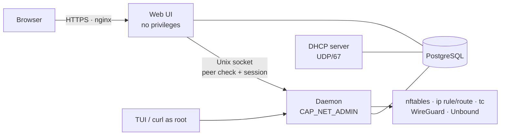

<div align="center">

🇺🇸 **English** · [🇪🇸 Español](README.es.md)

# 🛡️ NetFirewall

**A Linux firewall you run from a browser, where the database is the configuration.**

[](https://dotnet.microsoft.com/)
[](https://www.postgresql.org/)
[](https://wiki.nftables.org/)
[](LICENSE.txt)
[]()

</div>

Firewall rules, DHCP, WireGuard, two Internet links, QoS and policy routing, all kept in
one PostgreSQL database and turned into nftables, routes and tunnels by one small
privileged daemon. You manage it from a web UI, a console TUI or a shell. It runs on a
plain Debian or Ubuntu box and installs from a single tarball.


<sub>The dashboard on a production firewall with two WANs. Names, MAC addresses and public destinations are blurred.</sub>

## The idea

Most small firewalls are either a distribution you can't change or a pile of scripts
you're afraid to touch. NetFirewall is built on a few rules instead:

**The database is the configuration.** Every rule, lease, peer and route lives in
PostgreSQL. The kernel holds a copy derived from it: *Apply* regenerates the copy, the
box re-applies it at every boot, and the UI shows when the two have drifted apart. Back
up the database and you have backed up the firewall.

**Only one process can touch the kernel.** The web UI runs as an unprivileged user with
no capabilities. Every change to nftables, routes, `tc` or WireGuard goes through a
daemon on a Unix socket that checks who is calling (`SO_PEERCRED`) and with which session.
Breaking into the web process doesn't get you root, or the TOTP secrets.

**Every change can be taken back.** Destructive actions ask for your TOTP code again.
Applies keep a backup. An upgrade that doesn't come back healthy rolls itself back.
Splitting a VPN interface reverts on its own unless you confirm it within 10 minutes. A
rule whose objects resolve to nothing is skipped, never widened to "any".

**Nothing is fetched at run time.** Scripts, styles, fonts and even the PostgreSQL
repository key ship in the bundle, so the UI never loads anything from the Internet.

## What you can do with it

**Keep the Internet up.** Two WANs, each probed through its own routing mark so a test
really leaves by the link it's testing. When the primary fails, the default route moves.
When it comes back, the route moves back. Per-WAN traffic, latency and a speed test pinned to one link.

**Decide what talks to what.** Filter rules, NAT and port forwards built on named network
objects and FQDN sets instead of raw addresses. Time schedules ("block the kids' devices
after 22:00"), QoS shares per traffic class, and policy routing ("send the TV out through
the VPN provider"). A setup wizard writes a default-deny starting set for a gateway,
router or bastion.

**Run the LAN.** A DHCP server written in C# for this project, following RFC 2131, at about
a microsecond of CPU per packet. It does:
- reservations, with names you can `ping` because they're published to the firewall's DNS
- client classes, custom options for phones and access points, PXE and iPXE boot
- a ping check before handing out an address
- a 90-day lease history
- alerts when a pool fills up or another DHCP server appears on your network

Wake-on-LAN for saved devices.

**Connect from outside, and to the outside.** A WireGuard VPN server for laptops,
phones and branch sites, with QR configs. Separate *outbound* tunnels to a VPN provider or
a remote office, which you create by pasting their config. Tunnel-down alerts by banner
and email.

**See what's happening and why.** A live dashboard (above):
- which hosts use the most traffic, and where it goes, with the organisation and country behind each address
- per-WAN graphs
- CPU, memory and disk of the box

When something breaks:
- four "doctors" (WAN, VPN, DHCP, DNS) that check the whole chain and say what to fix
- a route oracle ("which link would this packet take?")
- a flow inspector that traces one connection through the kernel
- bounded packet captures
- a root terminal in the browser behind TOTP

**Administer it safely.** TOTP for every account, recovery codes, a full audit log, and
`netfirewall-tui` on the console to reset a password or a locked-out TOTP when the web isn't
an option. `netfirewall-doctor` checks a whole deployment in one table.

## Install

On Debian 12/13 or Ubuntu 22.04+ (x86_64 or arm64), as root. The bundle carries its own
.NET runtime; `setup.sh` installs whatever else is missing, including PostgreSQL 19 from
the official repository.

```bash
tar xzf netfirewall-0.9.0.tar.gz && cd netfirewall-0.9.0   # from GitHub Releases
./setup.sh --preflight     # checks the host; changes nothing
./setup.sh                 # installs, then runs netfirewall-doctor
journalctl -u netfirewall-web | grep -i bootstrap          # one-time link for the first admin
```

**Upgrade:** run `./setup.sh` from a newer bundle. It backs up the database, migrates,
switches, health-checks, and rolls back by itself if the new version doesn't come up.
**Roll back by hand:** `./setup.sh --rollback`.

Remote database, DHCP on a given interface, your own TLS certificate or proxy, ARM
builds, and what each step does when it fails: **[docs/setup.md](docs/setup.md)**.

## How it fits together



| Piece | What it does |
|---|---|
| `NetFirewall.Web` | ASP.NET Core MVC with HTMX, Alpine.js and Tailwind; data grids from [NetOpenGrid](https://github.com/mchinchilla/NetOpenGrid) |
| `NetFirewall.Daemon` | The only privileged process: applies state, runs the WAN/VPN monitors, the traffic sampler and the diagnostic tools |
| `NetFirewall.DhcpServer` | The DHCP server, its own systemd unit |
| `NetFirewall.Tui` · `NetFirewall.Doctor` · `NetFirewall.Migrations` | Console admin, deployment checker, forward-only schema migrations |
| `deploy/` | `build-bundle.sh` and `setup.sh`, hardened systemd units, nginx site, boot-time apply |

Every unit runs under a tight systemd sandbox (`ProtectSystem=strict`, capability bounding,
syscall filters). The daemon holds only `CAP_NET_ADMIN CAP_NET_RAW CAP_DAC_OVERRIDE CAP_CHOWN`.

## Limits

Worth knowing before you put it in front of your network:

- **IPv4 only.** No DHCPv6, no router advertisements, no IPv6 rules yet.
- **One box.** DHCP failover between two firewalls is disabled: the peer protocol isn't
  implemented, and turning it on used to stop DHCP on both.
- **Debian and Ubuntu** with systemd are the only tested hosts.
- **Two features call out on purpose:** the organisation/country of a destination comes from
  [ip.guide](https://ip.guide) (cached by prefix), and the speed test downloads test files.

## Develop

```bash
dotnet build                                          # also compiles Tailwind (standalone binary, never npm)
dotnet test                                           # ~1900 tests; the database ones need a local PostgreSQL
dotnet run --project NetFirewall.Migrations -- up     # migrate the dev database
dotnet run --project NetFirewall.AppHost              # Aspire: Web + ApiService + DHCP server
deploy/build-bundle.sh --rid linux-arm64              # a release bundle → dist/
```

The project's rules (no npm, async everywhere, one CSS and one JS file, theme tokens only,
no SQL in controllers…) are in [CLAUDE.md](CLAUDE.md). Every push to `master` runs the tests
and publishes the next release (`[minor]` / `[major]` / `[skip release]` in the commit
message change that).

## Documentation

| | |
|---|---|
| [setup.md](docs/setup.md) | Install, upgrade, rollback, every `setup.sh` option, PostgreSQL 19 |
| [operations.md](docs/operations.md) | Boot-time apply, failover logic, shell troubleshooting, schema history |
| [diagnostics.md](docs/diagnostics.md) | The Diagnostics section: tools, doctors, safety rules |
| [doctor.md](docs/doctor.md) | `netfirewall-doctor` checks and remedies |
| [master-key.md](docs/master-key.md) | The TOTP master key and the daemon ↔ Web sync rule |
| [DHCP_FEATURE_COMPARISON.md](docs/DHCP_FEATURE_COMPARISON.md) | DHCP features vs Kea, dnsmasq and MikroTik |
| [PerformanceAnalysis.md](docs/PerformanceAnalysis.md) | The DHCP hot path and its allocation rules |
| [wake-on-lan.md](docs/wake-on-lan.md) | Wake-on-LAN |

## License

MIT, see [LICENSE.txt](LICENSE.txt).
