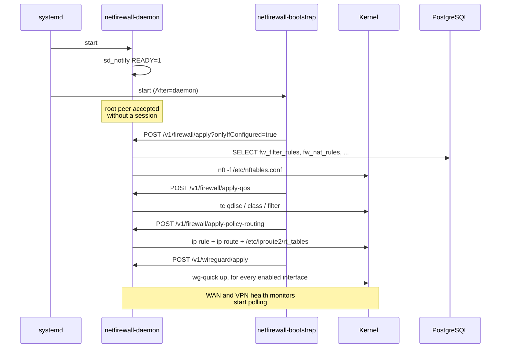
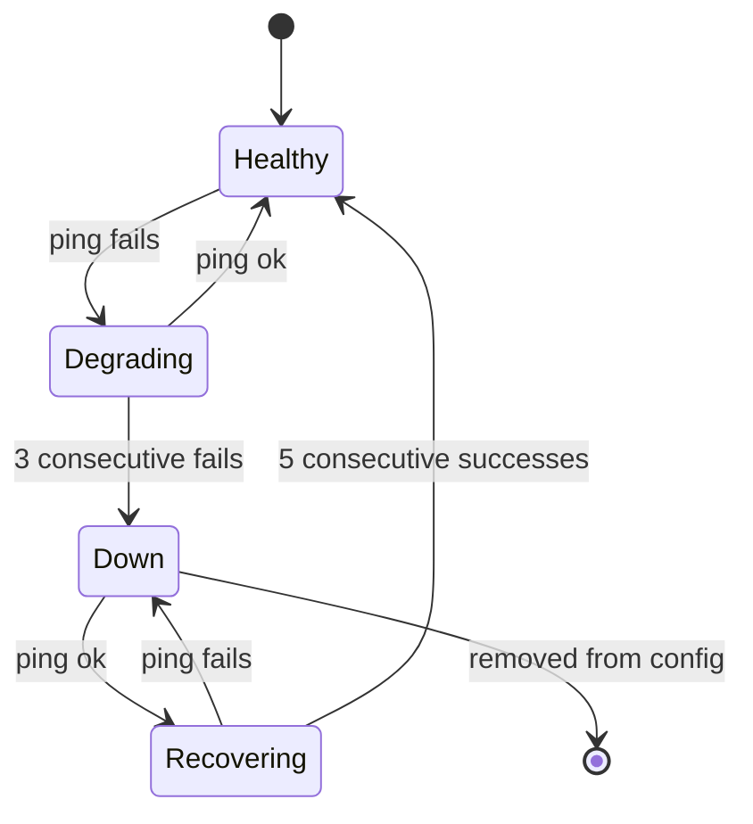

# Operations

Running NetFirewall day to day: how it applies state at boot, how dual-WAN failover
decides, the shell commands that answer "it's configured but it doesn't work", and
what each database migration added. Installing and upgrading are in
[`setup.md`](setup.md); the UI's own diagnostic tools are in [`diagnostics.md`](diagnostics.md).

- [Kernel prerequisites](#kernel-prerequisites)
- [Boot-time apply](#boot-time-apply)
- [Applying by hand](#applying-by-hand)
- [Shipping a code change](#shipping-a-code-change)
- [Dual-WAN failover](#dual-wan-failover)
- [Troubleshooting from a shell](#troubleshooting-from-a-shell)
- [Migrations and schema](#migrations-and-schema)
- [Audit and apply history](#audit-and-apply-history)
- [Deprecated pieces](#deprecated-pieces)

## Kernel prerequisites

The firewall is a router: IPv4 forwarding must be on, and the dashboard's top-talkers
panel needs conntrack byte accounting (`conntrack -L` only emits `bytes=` when
`nf_conntrack_acct=1`). `setup.sh` installs `/etc/sysctl.d/netfirewall.conf` plus the
modprobe / modules-load drop-ins that make `nf_conntrack_acct` survive reboots, but
**forwarding is your call**:

```bash
echo 'net.ipv4.ip_forward = 1' > /etc/sysctl.d/99-netfirewall-router.conf
sysctl --system
sysctl net.ipv4.ip_forward net.netfilter.nf_conntrack_acct
```

> **Policy routing + `rp_filter`:** strict reverse-path filtering
> (`net.ipv4.conf.*.rp_filter=1`) silently drops fwmark-routed traffic whose reply path
> differs from its inbound interface. If marked traffic refuses to leave by the intended
> WAN/VPN although `ip rule` and the route table look correct, loosen it:
> `sysctl -w net.ipv4.conf.all.rp_filter=2` (loose mode).

## Boot-time apply

The kernel forgets everything at reboot; the database doesn't. `netfirewall-bootstrap`
(a oneshot unit, `PartOf=` the daemon) pushes the database state back:



`onlyIfConfigured=true` means a box that has never been configured is not locked out by
an empty default-deny ruleset at boot. Because the unit is `PartOf=` the daemon, a daemon
restart re-applies the database state too.

## Applying by hand

As root, through the daemon's socket (a root peer needs no session):

```bash
SOCK=/run/netfirewall/control.sock
curl --unix-socket "$SOCK" -X POST http://daemon/v1/firewall/apply
curl --unix-socket "$SOCK" -X POST http://daemon/v1/firewall/apply-qos
curl --unix-socket "$SOCK" -X POST http://daemon/v1/firewall/apply-policy-routing
curl --unix-socket "$SOCK" -X POST http://daemon/v1/wireguard/apply             # every enabled interface
curl --unix-socket "$SOCK" -X POST "http://daemon/v1/wireguard/apply?name=wg0"  # just one
```

## Shipping a code change

Editing source changes **nothing** in the kernel until a new release is running and
re-applied. Push to `master` (every push publishes the next release) or take a bundle
from the Release workflow, then on the firewall:

```bash
tar xzf netfirewall-0.9.1.tar.gz && cd netfirewall-0.9.1 && ./setup.sh
# then: UI → Firewall → Apply (TOTP), or the curl calls above
```

## Dual-WAN failover

The daemon's `WanHealthMonitorService` runs every 30 s by default. For each enabled
`wan_health_config` row:

1. **Probe**: `ping -m <fwmark>` to every monitor target. The fwmark makes the kernel honour `ip rule fwmark X lookup wanN`, so the probe leaves by the WAN under test even when the main table points elsewhere.
2. **Hysteresis**: 3 consecutive failures mark the WAN down; 5 consecutive successes mark it up.
3. **Reconcile**: the healthy WAN with the lowest priority wins. If the winner changed: `ip route replace default via <gw> dev <iface>` in the main table.
4. **Audit**: `wan_health_events` records every transition; `fw_apply_history` records each failover.



A service DNAT'd on the secondary WAN also needs connection-mark steering, or its replies
leave by the primary and die upstream: give **both** WANs a `probe_fwmark`.

## Troubleshooting from a shell

Most of this is in the UI under **Diagnostics** (tools, four doctors, history). From a
shell, walk the chain from the kernel down. Everything here is read-only and safe on a
live box.

**Services & sockets**

```bash
systemctl status netfirewall-daemon netfirewall-web netfirewall-dhcp
journalctl -u netfirewall-daemon -n 100 --no-pager
journalctl -u netfirewall-web    -n 100 --no-pager
ls -l /run/netfirewall/control.sock                    # daemon socket (0660 root:netfirewall)
curl --unix-socket /run/netfirewall/control.sock http://daemon/v1/health
netfirewall-doctor                                     # the whole deployment in one table
```

**nftables: is the ruleset what you expect?**

```bash
nft list ruleset                       # everything
nft list table ip filter               # filter chains
nft list table ip nat                  # DNAT / masquerade
nft list table ip mangle               # fwmark marking (policy routing)
nft -c -f /etc/nftables.conf           # validate the generated file WITHOUT applying
```

> Mangle gotcha: each marking rule must end in `... meta mark set 0xNNN return`.
> `meta mark set` is **not** terminal: without `return`, a later broad rule
> (e.g. `192.168.99.0/24 → WAN1`) overwrites the mark of a specific host above it, and
> that host silently leaves by the wrong link.

**Policy routing: does the mark reach the right table and device?**

```bash
ip rule show                                       # fwmark → table mappings
ip route show table all | grep -i wg               # routes per table
cat /etc/iproute2/rt_tables                         # table-name registrations

# the definitive test: which device would a marked packet from host X use?
ip route get 8.8.8.8 from 192.168.99.66 mark 0x500   # expect: dev wgc1
```

**Connection tracking (top-talkers panel empty)**

```bash
which conntrack || apt install -y conntrack
sysctl net.netfilter.nf_conntrack_acct              # MUST be 1, or bytes= is missing
sysctl -w net.netfilter.nf_conntrack_acct=1          # enable live if it's 0
conntrack -L -o extended 2>/dev/null | head -3 | grep -o "bytes=[0-9]*"
journalctl -u netfirewall-daemon --since "10 min ago" | grep -i "conntrack\|sampler"
```

**WireGuard**

```bash
wg show                                  # every interface: peers, handshakes, transfer
wg show wg0 allowed-ips
ip -br link show type wireguard          # which tunnels are up
```

**DHCP**

```bash
ss -ulpn 'sport = :67'                               # the server is listening
journalctl -u netfirewall-dhcp -n 100 --no-pager
head /etc/unbound/unbound.conf.d/netfirewall-hosts.conf   # names published to DNS
```

**WAN / forwarding**

```bash
sysctl net.ipv4.ip_forward                          # must be 1 for a router
ping -m 256 -c2 1.1.1.1                              # test a WAN by its fwmark (-I is ignored by policy routing)
ip route show default
```

## Migrations and schema

```bash
netfirewall-migrate status   # applied / pending / drifted
netfirewall-migrate up       # apply pending (setup.sh does this on every upgrade, before switching binaries)
```

Forward-only: to undo a change, write a new migration. The `__migrations` table keeps the
SHA-256 of every applied file, and the runner refuses to continue if one was edited.

| Range | Domain |
|---|---|
| `00001–00004` | Extensions + firewall core (interfaces, filter/NAT/mangle rules, traffic marks, static routes, QoS, audit log) |
| `00005–00010` | DHCP (subnets, pools, options, relay, failover, DDNS) + setup wizard |
| `00011` | Auth (users, sessions, TOTP secrets, auth audit log) |
| `00012–00013` | System metrics + app settings |
| `00014, 00021` | WireGuard (servers, peers, modes) |
| `00015–00020` | Network objects, FQDN sets, user profile, search index, schedules, services |
| `00022` | Apply history (per-kind drift detection) |
| `00023` | Policy routing (named tables + fwmark rules) |
| `00024` | LAN traffic samples (conntrack top talkers) |
| `00025–00026` | WAN health + probe fwmark |
| `00027–00029` | Per-destination traffic, ASN cache, network metrics |
| `00030–00031` | Global search index (DHCP + firewall) |
| `00032–00033, 00036–00037` | WireGuard route modes, VPN health monitor, peer roles |
| `00034–00035` | WAN health auto-seed + manual active-WAN override |
| `00038–00040` | DHCP lease-delete notify, schedule inversion, orphan cleanup |
| `00041` | Diagnostics run history |
| `00042` | Wake-on-LAN devices |
| `00043–00044` | Dismissable system alerts, DHCP reservation notify |
| `00045` | One WireGuard interface per role (unique, link-safe names) |
| `00046–00049` | DHCP: iPXE boot file, custom options, reservation host names, lease history |
| `00050` | WireGuard split journal (confirm or revert; the daemon reverts an unconfirmed split after 10 min) |

## Audit and apply history

```sql
SELECT event_type, username, ip, occurred_at FROM auth_audit_log ORDER BY occurred_at DESC LIMIT 20;
SELECT kind, success, applied_at, applied_by, message FROM fw_apply_history ORDER BY applied_at DESC LIMIT 20;
```

## Deprecated pieces

Kept in the repository for reference, no longer active in production:

| Item | Replaced by | Notes |
|---|---|---|
| `/root/firewall.sh` (or `Bash/firewall.sh`) | `netfirewall-bootstrap.service` + `fw_policy_rules` / `fw_route_tables` | The old script ran `ip rule add` / `ip route add` directly; the daemon now reconciles them from the database. |
| `NetFirewall.WanMonitor` (standalone process) | `WanHealthMonitorService` inside the daemon | The old monitor shelled out and kept no state; the new one persists `wan_health_state` + `wan_health_events`. |
| `netfirewall-wanmonitor.service` | (absorbed into the daemon) | Disable and remove it when upgrading from a pre-2026-05 deployment. |
| `wg-quick@wg0.service` | Daemon-managed WireGuard interfaces | The daemon brings every interface up; the systemd unit was never used. |
| DHCP failover | (disabled) | The peer protocol is not implemented; enabling it used to stop DHCP on both boxes. Peers can be recorded but are ignored. |
| `deploy/install.sh` (compiled on the server) | Release bundle + `setup.sh` | Needed the .NET SDK on the firewall; no versioning, no rollback. |
| Appliance `.deb` + Debian 13 ISO | Release bundle + `setup.sh` | Hard to upgrade on a running firewall; removed. |
